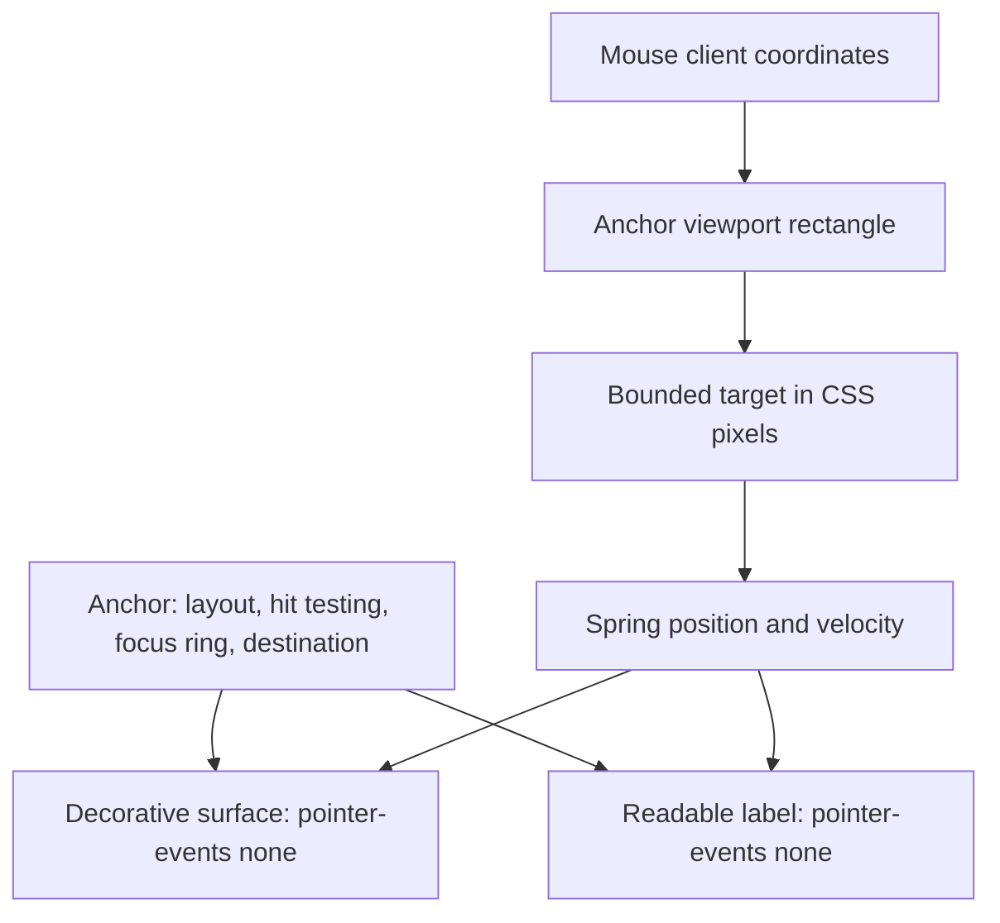

# Lesson 1 — Pointer geometry, magnetic hover and springs

**18 November 2026 · Asia/Tehran.** This lesson follows [the foundations](FOUNDATIONS.md) and turns Phase 1 into a documented, independently implemented exercise. It includes executable snippets and verification, not a portfolio page. No Animorio implementation or artwork is reproduced.

References: [Magnetic button](https://animorio.com/en/animations/magnetic-button/) and [Projects with elastic lines](https://animorio.com/en/animations/projects-with-elastic-lines/). Their standalone scripts were reviewed in [the initial study](SOURCE-REVIEW.md); source hashes remain in [evidence.json](evidence.json). This lesson adds original teaching code and local tests. It does not claim additional live-site or framework-adapter review.

## What to learn from the two references

The magnetic button separates stable measurement geometry from animated surfaces, and gives body and label different responses. The elastic project rows retain velocity when a line releases. Together they teach a reusable sequence:

**Input → coordinates → target → current position and velocity → rendered layers.**

Use this for a small decorative response on a prominent project link or contact action. The label and destination must already be understandable before hover. A magnetic effect is not a reason to move a navigation target away from the pointer or require hovering to discover essential content.

| Concept      | Magnetic reference                | Elastic-line reference          | This exercise                                              |
| ------------ | --------------------------------- | ------------------------------- | ---------------------------------------------------------- |
| Measurement  | Stationary wrapper                | Layout offsets and SVG bounds   | Untransformed anchor rectangle                             |
| Motion model | Damped follow plus elastic return | Numerically integrated springs  | Closed-form underdamped spring                             |
| Rendering    | Body, label, glow and ring        | Split text, preview, SVG curve  | Surface and label; scalar SVG mapping explained separately |
| Touch        | Press feedback                    | Touch toggle / line interaction | Ordinary link behavior and native scrolling                |
| Navigation   | Placeholder destinations          | Clicks prevented in demo        | Real same-document destination, default action preserved   |

## 1. Establish a stationary hit region



The anchor never receives a translation. Its visual children cannot enlarge the clickable area because they have `pointer-events: none`. A visible child can extend beyond the anchor, so keep displacements small; the original hit region remains the reliable target. If an interaction requires a bigger target, increase the anchor's layout padding.

The following markup is a testable documentation fragment. Keep an actual destination or native button semantics in a future implementation. A button activates on Space and Enter; a link normally activates on Enter. Do not synthesize button behavior for a link.

```html
<a class="study-link" href="#project-notes">
  <span class="study-surface" aria-hidden="true"></span>
  <span class="study-label">Read project notes</span>
</a>
<section id="project-notes" tabindex="-1">
  <h2>Project notes</h2>
  <p>The destination and label work without animation.</p>
</section>
```

```css
.study-link {
  position: relative;
  display: inline-flex;
  padding: 1rem 1.5rem;
  isolation: isolate;
  color: #fff;
  text-decoration: none;
  touch-action: auto;
}
.study-surface {
  position: absolute;
  inset: 0;
  z-index: -1;
  border-radius: 0.5rem;
  background: #24364b;
  pointer-events: none;
}
.study-label {
  pointer-events: none;
}
.study-link:focus-visible {
  outline: 3px solid #1765ad;
  outline-offset: 6px;
}
@media (prefers-reduced-motion: reduce) {
  .study-surface,
  .study-label {
    translate: none !important;
  }
}
```

These neutral colors demonstrate the layers; they are not a proposed portfolio visual direction. There is no hidden title, hover-only description or animated focus target. The media rule also prevents visible displacement before JavaScript reacts to a changed motion preference.

## 2. Convert coordinates once, then bound the target

```js
function pointerTarget(clientX, clientY, rect, limit = 10) {
  const values = [
    clientX,
    clientY,
    rect.left,
    rect.top,
    rect.width,
    rect.height,
    limit,
  ];
  if (
    !values.every(Number.isFinite) ||
    rect.width <= 0 ||
    rect.height <= 0 ||
    limit < 0
  ) {
    return { x: 0, y: 0 };
  }
  const clamp = (n) => Math.max(-1, Math.min(1, n));
  return {
    x: clamp(((clientX - rect.left) / rect.width) * 2 - 1) * limit,
    y: clamp(((clientY - rect.top) / rect.height) * 2 - 1) * limit,
  };
}
```

`clientX/clientY` and the rectangle are both in viewport pixels. Normalizing each axis makes the limit independent of label width. With a 10 px limit, each axis stays within ±10 px; diagonal displacement can reach approximately 14.1 px. For a radial limit, normalize and clamp vector length instead.

Do not add `scrollX/scrollY` to only one side of this calculation. The controller below reads the anchor rectangle on each mouse move and resets on scroll or resize. That is an intentional simple measurement policy: no stale cached geometry, and no layout reads inside the animation frame. In a large interactive list, coalesce pointer events and measure once per frame before writes.

This rectangle approach assumes an axis-aligned, unscaled anchor and ancestors. Rotation, skew, scale or perspective require mapping through an inverse transform to obtain local CSS pixels. Nested scrolling is addressed by the scroll reset; transformed coordinate systems are not.

## 3. Preserve velocity with a spring

A follower in [FOUNDATIONS.md](FOUNDATIONS.md) smoothly approaches a target without overshooting. A spring stores position **and** velocity. When the target changes, retain both; resetting velocity on every pointer event destroys continuity.

For mass normalized to one, acceleration is `−ω²(x − target) − 2ζωv`. Here `ω` is angular frequency in radians/second and `ζ` is damping ratio. A ratio between zero and one is underdamped and can overshoot. The code below solves that case analytically for a target held constant during each time interval; it deliberately rejects other regimes rather than silently applying the wrong formula.

```js
function springStep(state, target, dt, omega = 22, zeta = 0.65) {
  if (
    ![state.x, state.v, target, dt, omega, zeta].every(Number.isFinite) ||
    dt < 0 ||
    omega <= 0 ||
    zeta <= 0 ||
    zeta >= 1
  ) {
    throw new RangeError(
      "Finite state; dt >= 0, omega > 0, and 0 < zeta < 1 required",
    );
  }
  if (dt === 0) return { ...state };
  const decayRate = zeta * omega;
  const frequency = omega * Math.sqrt(1 - zeta * zeta);
  const offset = state.x - target;
  const fade = Math.exp(-decayRate * dt);
  const cosine = Math.cos(frequency * dt);
  const sine = Math.sin(frequency * dt);
  return {
    x:
      target +
      fade *
        (offset * cosine + ((state.v + decayRate * offset) / frequency) * sine),
    v:
      fade *
      (state.v * cosine -
        ((decayRate * state.v + omega * omega * offset) / frequency) * sine),
  };
}
```

For a constant target, subdividing the same elapsed time into 30, 60 or 120 updates gives the same endpoint within floating-point tolerance. Real moving targets are sampled at different times, so that does not imply identical paths for every input device or refresh rate. The controller caps frame elapsed time at 40 ms to avoid large jumps after a stall; this intentionally stops matching wall-clock elapsed time during stalls.

The sample values are teaching choices. Raise frequency for a faster response; raise damping toward one for less overshoot. If motion takes attention away from the content, remove it or use a monotonic follower. A spring is a behavioral choice, not a default quality improvement.

## 4. Give the interaction an explicit lifecycle

| Event                                        | State/output policy                                                | Native behavior                        |
| -------------------------------------------- | ------------------------------------------------------------------ | -------------------------------------- |
| Fine mouse moves within anchor               | Update bounded target and wake one RAF loop                        | Unchanged                              |
| Pointer leaves                               | Target returns to zero; preserve velocity                          | Unchanged                              |
| Pointer down, cancel or lost capture         | Cancel motion and reset immediately                                | No preventDefault or capture           |
| Keyboard focus becomes visible               | Reset; keep focus ring and label stationary                        | Enter activates link                   |
| Touch or pen input                           | No magnetic displacement                                           | Native link and vertical scrolling     |
| Reduced-motion or pointer capability changes | Cancel frame, zero state                                           | Content stays available                |
| Scroll, resize, blur or hidden document      | Reset rather than reuse stale geometry                             | Browser owns scrolling/focus           |
| Settled spring                               | Stop scheduling RAF                                                | Next eligible pointer move can wake it |
| Destroy                                      | Cancel RAF, detach listeners/observer, restore owned inline styles | Anchor remains usable                  |

This hover controller never captures a pointer. Lost-capture handling is defensive; a separate drag interaction would need a pointer ID, explicit capture ownership and its own cancellation model. Avoid sharing this decorative controller with a drag-to-navigate component.

```js
function mountPointerStudy(hit) {
  const surface = hit.querySelector(".study-surface");
  const label = hit.querySelector(".study-label");
  if (!surface || !label) throw new Error("Surface and label are required");
  const reduced = matchMedia("(prefers-reduced-motion: reduce)");
  const fine = matchMedia("(any-hover: hover) and (any-pointer: fine)");
  const events = new AbortController();
  const layers = [surface, label];
  const originals = layers.map((layer) => ({
    value: layer.style.getPropertyValue("translate"),
    priority: layer.style.getPropertyPriority("translate"),
  }));
  let x = { x: 0, v: 0 },
    y = { x: 0, v: 0 };
  let target = { x: 0, y: 0 };
  let frame = null,
    previous = 0,
    disposed = false;

  function render() {
    surface.style.translate = `${x.x}px ${y.x}px`;
    label.style.translate = `${x.x * 0.3}px ${y.x * 0.3}px`;
  }
  function reset() {
    if (frame !== null) cancelAnimationFrame(frame);
    frame = null;
    x = { x: 0, v: 0 };
    y = { x: 0, v: 0 };
    target = { x: 0, y: 0 };
    render();
  }
  function allowed() {
    return (
      !disposed &&
      !reduced.matches &&
      fine.matches &&
      !document.hidden &&
      !hit.matches(":focus-visible")
    );
  }
  function tick(now) {
    frame = null;
    if (!allowed()) {
      reset();
      return;
    }
    const dt = Math.min(0.04, Math.max(0, (now - previous) / 1000));
    previous = now;
    x = springStep(x, target.x, dt);
    y = springStep(y, target.y, dt);
    const settled =
      Math.hypot(x.x - target.x, y.x - target.y) < 0.01 &&
      Math.hypot(x.v, y.v) < 0.05;
    if (settled) {
      x = { x: target.x, v: 0 };
      y = { x: target.y, v: 0 };
    }
    render();
    if (!settled) frame = requestAnimationFrame(tick);
  }
  function wake() {
    if (frame !== null || !allowed()) return;
    previous = performance.now();
    frame = requestAnimationFrame(tick);
  }
  function listen(owner, type, handler, options = {}) {
    owner.addEventListener(type, handler, {
      ...options,
      signal: events.signal,
    });
  }
  listen(hit, "pointermove", (event) => {
    if (event.pointerType !== "mouse" || event.buttons !== 0 || !allowed()) {
      reset();
      return;
    }
    target = pointerTarget(
      event.clientX,
      event.clientY,
      hit.getBoundingClientRect(),
    );
    wake();
  });
  listen(hit, "pointerleave", () => {
    target = { x: 0, y: 0 };
    wake();
  });
  for (const type of [
    "pointerdown",
    "pointercancel",
    "lostpointercapture",
    "focusin",
  ])
    listen(hit, type, reset);
  listen(window, "scroll", reset, { capture: true, passive: true });
  listen(window, "resize", reset);
  listen(window, "blur", reset);
  listen(document, "visibilitychange", reset);
  listen(reduced, "change", reset);
  listen(fine, "change", reset);
  const observer = new ResizeObserver(reset);
  observer.observe(hit);

  return {
    destroy() {
      if (disposed) return;
      disposed = true;
      events.abort();
      observer.disconnect();
      reset();
      layers.forEach((layer, index) => {
        const old = originals[index];
        if (old.value)
          layer.style.setProperty("translate", old.value, old.priority);
        else layer.style.removeProperty("translate");
      });
    },
  };
}
```

Load the three JavaScript blocks in order, then call `mountPointerStudy(anchor)` after the markup exists. Call its returned `destroy()` **before** mounting another controller on the same anchor or removing it. The controller exclusively owns these two layers' individual `translate` properties while mounted. It restores their previous inline values and priorities when destroyed. Do not attach another animation to those same properties.

This uses modern `ResizeObserver`, AbortSignal event cleanup, media-query change events and individual CSS transforms. If those APIs are unavailable, leave the native link unenhanced. A production integration should also scope measurements and global events for many instances; this one-link exercise favors inspectability over a shared dispatcher.

## 5. Apply the same spring to an SVG line

For a line of width `W`, store a scalar control-point displacement `bend` and velocity. Render a quadratic path conceptually as `M 0 0 Q W/2 bend W 0`. The visible midpoint is **bend/2**, because a quadratic curve weights its control point by `2t(1−t)` and `t=0.5` at the middle. To move the visible midpoint down 20 px, use a 40 px control displacement.

On release, target the control displacement back to zero while preserving velocity. If the curve is decorative, set its SVG to `aria-hidden` and `pointer-events: none`; do not intercept the project link. Geometry for variable grab positions requires a more explicit curve model than one centered control point. This lesson explains the scalar mapping; a draggable SVG component and its browser tests remain outside its scope.

## Verification and completion boundary

Run `node docs/animation-learning/animorio/verify-pointer-lesson.cjs` for numeric and source-extracted checks. Add `--browser` in an environment with Playwright and Chromium installed to exercise the actual snippets in a temporary, in-memory fixture. No demo site is written or served. See [the recorded results](pointer-lesson-validation.json) for the tested runtime and scenarios.

Checks cover spring overshoot, convergence, fixed-target refresh-rate equivalence, interrupted velocity continuity, invalid inputs, stable hit bounds, native link activation, focus reset, live reduced-motion changes, separately configured touch emulation, scroll reset, cancellation and repeated mount/destroy with no surviving RAF callbacks. They do not certify screen-reader behavior, real-device scrolling, transformed ancestors or application-wide performance.

The Phase 1 lesson and this scoped exercise are complete when these checks pass. Real-device touch, assistive-technology review and a full draggable line remain unverified. Phase 2 can now build on the same distinction between stationary measurement geometry and moving visual layers.
