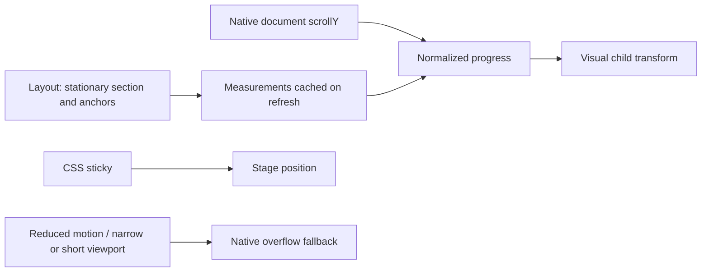

# Lesson 2 — Sticky positioning and scroll progress

**20 November 2026 · Asia/Tehran.** Original documentation exercises following [Lesson 1](01-pointer-and-springs.md). References: [Stacking cards](https://animorio.com/en/animations/stacking-cards/) and [Reportage horizontal gallery](https://animorio.com/en/animations/reportage-horizontal-gallery/). Their reviewed source versions are recorded in [evidence.json](evidence.json). This lesson uses independently written snippets, not Animorio source or artwork.

## The mechanism before the effect

CSS sticky positioning holds a box within its containing block. Scroll progress maps a measured interval to a number between zero and one. A renderer turns that number into scale, shading or translation. Keep those responsibilities separate:



The card reference uses CSS sticky for each card and the next stationary anchor to drive decoration on the previous card. The gallery reference uses one scroll-progress value to coordinate track movement, focus and parallax. Neither needs JavaScript pinning merely to stay in place. The gallery's Lenis integration is optional; this lesson uses native scrolling throughout.

## 1. Derive the interval

For document top `D`, sticky inset `T`, containing-section height `H` and stage height `h`:

- Sticky starts at document scroll `S = D − T`.
- Sticky ends at `E = D + H − h − T`.
- Usable travel is `E − S = H − h`.
- Progress is `clamp((scrollY − S) / (E − S), 0, 1)`.

This assumes a window scroller, an untransformed ancestor chain and a section without padding/borders altering the stage's containing geometry. Nested scrollers need their own scroll coordinate and rectangle conversion. The example makes these assumptions explicit instead of mixing window scroll with a nested container.

```js
function scrollProgress(position, start, travel) {
  if (![position, start, travel].every(Number.isFinite) || travel <= 0)
    return 0;
  return Math.max(0, Math.min(1, (position - start) / travel));
}

function galleryTravel(trackWidth, viewportWidth, lastCenter) {
  if (
    ![trackWidth, viewportWidth, lastCenter].every(Number.isFinite) ||
    trackWidth < 0 ||
    viewportWidth <= 0
  ) {
    throw new RangeError(
      "Finite geometry and positive viewport width required",
    );
  }
  return {
    alignEnd: Math.max(0, trackWidth - viewportWidth),
    centerLast: Math.max(0, lastCenter - viewportWidth / 2),
  };
}

function coveredCard(nextAnchorDocumentY, scrollY, viewportHeight, stickyTop) {
  const start = nextAnchorDocumentY - viewportHeight;
  const travel = viewportHeight - stickyTop;
  const progress = scrollProgress(scrollY, start, travel);
  return { scale: 1 - 0.06 * progress, shade: 0.2 * progress };
}
```

Suppose the track is 1,800 px wide, its viewport is 900 px wide and its last item center is at 1,600 px. End alignment requires 900 px of translation; centering the last item requires 1,150 px. These are different compositions. Centering can expose empty space after the final item; provide deliberate trailing space if using native overflow to reproduce it. This exercise chooses **end alignment**, so the final item's right edge reaches the viewport's right edge.

If section height equals stage height, there is no sticky travel. If the track fits, there is no horizontal travel. Both cases should keep usable static content, not divide by zero or invent a long empty scrolling section.

## 2. Stack cards with CSS first

The anchor and sticky card are siblings. The inner visual can later scale without corrupting the anchor's measured document position. The final spacer lets the last card reach its sticky position; a sticky element cannot remain stuck beyond its containing block.

```html
<section class="lesson-stack" aria-label="Three stages of a project">
  <span class="card-anchor" aria-hidden="true"></span>
  <article class="lesson-card" style="--index:0">
    <div class="card-visual">
      <h2>Question</h2>
      <p>Define what the project should clarify.</p>
    </div>
  </article>
  <span class="card-anchor" aria-hidden="true"></span>
  <article class="lesson-card" style="--index:1">
    <div class="card-visual">
      <h2>Experiment</h2>
      <p>Show the decisions and their evidence.</p>
    </div>
  </article>
  <span class="card-anchor" aria-hidden="true"></span>
  <article class="lesson-card" style="--index:2">
    <div class="card-visual">
      <h2>Result</h2>
      <p>Explain what changed and what remains uncertain.</p>
    </div>
  </article>
</section>
```

```css
.lesson-stack {
  padding-bottom: 80vh;
}
.card-anchor {
  display: block;
  height: 1px;
}
.lesson-card {
  position: sticky;
  top: calc(24px + var(--index) * 12px);
  margin-bottom: 160px;
}
.card-visual {
  box-sizing: border-box;
  min-height: 240px;
  padding: 32px;
  background: #e8eef3;
  border: 1px solid #526479;
  transform-origin: top center;
}
@media (prefers-reduced-motion: reduce),
  (max-height: 500px),
  (max-width: 600px) {
  .lesson-stack {
    padding-bottom: 0;
  }
  .lesson-card {
    position: static;
    margin-bottom: 24px;
  }
}
```

This exercise tests the sticky layout and the pure `coveredCard` mapping separately. It deliberately does not ship a second animation controller. For a later decorated stack, cache every **stationary anchor's** `getBoundingClientRect().top + scrollY` and each card's computed sticky inset during refresh. On scroll, call `coveredCard` using the next anchor, then write the result to the previous card's **inner visual** and a decorative overlay. Re-read insets after breakpoints; do not measure a scaled card to derive its own progress. The last card has no next anchor and stays unscaled.

Reduced motion here switches to ordinary stacked articles. This differs from the reviewed reference, whose reduced branch keeps sticky layout. Long copy can exceed the viewport at any width: for production content, fall back to a normal list when the tallest card plus its inset does not fit. The compact sample does not claim automatic content-fit detection for cards.

## 3. Make the gallery usable before enhancement

The baseline is a labeled, focusable native horizontal scroller with a visible scrollbar. The controller adds previous/next buttons and optionally maps document scrolling to track translation. The sample items contain no focusable descendants: keyboard users operate the viewport or the external buttons. A gallery containing project links needs a focus-to-item contract or should retain native overflow in all modes.

```html
<section class="lesson-gallery" aria-labelledby="gallery-title">
  <div class="gallery-stage">
    <h2 id="gallery-title">Project sequence</h2>
    <p id="gallery-help">
      Scroll through the sequence. Focus the gallery and use Left, Right, Home
      or End.
    </p>
    <div class="gallery-controls" hidden>
      <button type="button" data-step="-1" aria-controls="gallery-window">
        Previous item
      </button>
      <button type="button" data-step="1" aria-controls="gallery-window">
        Next item
      </button>
    </div>
    <div
      class="gallery-window"
      id="gallery-window"
      tabindex="0"
      role="region"
      aria-label="Project sequence items"
      aria-describedby="gallery-help"
    >
      <div class="gallery-track">
        <figure>
          <h3>Discover</h3>
          <p>Gather questions and constraints.</p>
        </figure>
        <figure>
          <h3>Explore</h3>
          <p>Compare possible directions.</p>
        </figure>
        <figure>
          <h3>Build</h3>
          <p>Test a focused hypothesis.</p>
        </figure>
        <figure>
          <h3>Reflect</h3>
          <p>Document evidence and limitations.</p>
        </figure>
      </div>
    </div>
  </div>
</section>
```

```css
.lesson-gallery {
  padding: 0;
  border: 0;
}
.gallery-stage {
  box-sizing: border-box;
  padding: 16px;
  background: #f3f5f7;
}
.gallery-window {
  overflow-x: auto;
  overscroll-behavior-x: contain;
}
.gallery-window:focus-visible {
  outline: 3px solid #1765ad;
  outline-offset: 3px;
}
.gallery-track {
  display: flex;
  gap: 24px;
  position: relative;
}
.gallery-track figure {
  flex: 0 0 min(70vw, 420px);
  box-sizing: border-box;
  min-height: 200px;
  margin: 0;
  padding: 24px;
  border: 1px solid #526479;
}
.lesson-gallery.is-linked .gallery-stage {
  position: sticky;
  top: 16px;
}
.lesson-gallery.is-linked .gallery-window {
  overflow: hidden;
}
.gallery-controls {
  margin-bottom: 16px;
}
```

The short text is a neutral fixture for geometry. There are no external images, fonts or visual assets. Without JavaScript, no content is hidden and the viewport uses the browser's horizontal scroll behavior. JavaScript adds Home/End handling; the baseline only promises native behavior, which varies by browser.

## 4. Measure on refresh, render on scroll

The controller below chooses native overflow for reduced motion, widths under 640 px, content too tall to fit in the sticky viewport, or zero horizontal travel. One horizontal pixel corresponds to one vertical scroll pixel in linked mode. Changing that ratio is a deliberate pacing decision, not an easing function.

```js
function mountScrollLesson(root) {
  const stage = root.querySelector(".gallery-stage");
  const viewport = root.querySelector(".gallery-window");
  const track = root.querySelector(".gallery-track");
  const controls = root.querySelector(".gallery-controls");
  const items = [...track.children];
  const motion = matchMedia("(prefers-reduced-motion: reduce)");
  const events = new AbortController();
  const originals = {
    height: root.style.height,
    translate: track.style.translate,
    hidden: controls.hidden,
  };
  let frame = null,
    dirty = true,
    disposed = false;
  let geometry = { linked: false, start: 0, travel: 0, stops: [0] };
  controls.hidden = false;

  function measure() {
    const width = viewport.clientWidth;
    const last = items.at(-1);
    const center = last ? last.offsetLeft + last.offsetWidth / 2 : 0;
    const travel =
      width > 0 ? galleryTravel(track.scrollWidth, width, center).alignEnd : 0;
    const height = stage.getBoundingClientRect().height;
    const linked =
      !motion.matches &&
      innerWidth >= 640 &&
      height + 32 < innerHeight &&
      travel > 0;
    root.classList.toggle("is-linked", linked);
    const wantedHeight = linked ? `${height + travel}px` : originals.height;
    if (root.style.height !== wantedHeight) root.style.height = wantedHeight;
    if (linked) viewport.scrollLeft = 0;
    else track.style.translate = "none";
    geometry = {
      linked,
      start: root.getBoundingClientRect().top + scrollY - 16,
      travel,
      stops: [
        ...new Set([
          0,
          ...items.map((item) => Math.min(travel, item.offsetLeft)),
          travel,
        ]),
      ].sort((a, b) => a - b),
    };
  }
  function render() {
    if (geometry.linked) {
      const progress = scrollProgress(scrollY, geometry.start, geometry.travel);
      track.style.translate = `${-progress * geometry.travel}px 0px`;
    }
  }
  function schedule() {
    if (disposed || frame !== null) return;
    frame = requestAnimationFrame(() => {
      frame = null;
      if (dirty) {
        dirty = false;
        measure();
      }
      render();
    });
  }
  function refresh() {
    dirty = true;
    schedule();
  }
  function go(direction) {
    if (disposed) return;
    // Input may arrive before a pending refresh; use current layout first.
    if (dirty) {
      dirty = false;
      measure();
    }
    const { linked, start, travel, stops } = geometry;
    const position = linked
      ? scrollProgress(scrollY, start, travel) * travel
      : viewport.scrollLeft;
    let destination;
    if (direction === "first") destination = 0;
    else if (direction === "last") destination = travel;
    else if (direction > 0)
      destination = stops.find((stop) => stop > position + 1) ?? travel;
    else
      destination =
        [...stops].reverse().find((stop) => stop < position - 1) ?? 0;
    if (linked)
      window.scrollTo({ top: start + destination, behavior: "instant" });
    else viewport.scrollTo({ left: destination, behavior: "instant" });
    schedule();
  }
  function listen(owner, type, callback, options = {}) {
    owner.addEventListener(type, callback, {
      ...options,
      signal: events.signal,
    });
  }
  listen(window, "scroll", schedule, { passive: true });
  listen(window, "resize", refresh);
  listen(motion, "change", refresh);
  listen(root, "load", refresh, { capture: true });
  listen(viewport, "keydown", (event) => {
    if (
      event.target !== viewport ||
      event.altKey ||
      event.ctrlKey ||
      event.metaKey ||
      event.shiftKey
    )
      return;
    const key = { ArrowLeft: -1, ArrowRight: 1, Home: "first", End: "last" }[
      event.key
    ];
    if (key === undefined) return;
    event.preventDefault();
    go(key);
  });
  for (const button of controls.querySelectorAll("button"))
    listen(button, "click", () => go(Number(button.dataset.step)));
  const observer = new ResizeObserver(refresh);
  for (const element of [document.body, stage, viewport, ...items])
    observer.observe(element);
  document.fonts.ready.then(() => {
    if (!disposed) refresh();
  });
  listen(document.fonts, "loadingdone", refresh);
  refresh();
  return {
    refresh,
    destroy() {
      if (disposed) return;
      disposed = true;
      events.abort();
      observer.disconnect();
      if (frame !== null) cancelAnimationFrame(frame);
      frame = null;
      root.classList.remove("is-linked");
      root.style.height = originals.height;
      track.style.translate = originals.translate;
      controls.hidden = originals.hidden;
    },
  };
}
```

Load both JavaScript blocks in order and call `mountScrollLesson(gallerySection)` once. The controller owns the `is-linked` class, section height and track translation; the sample assumes they are initially unassigned and not marked `!important`. Destroy before re-mounting. Preserve the original declarations differently if integrating into a component with existing style ownership.

`measure()` intentionally reads layout and changes mode/section height during refresh. Ordinary scroll frames only read document `scrollY` and write translation. ResizeObserver notifications can schedule another settling refresh after the section changes height; assigning height only when different prevents a self-perpetuating size loop. No continuous RAF loop is needed while idle.

Fonts, item sizes, window size and image load invalidate measurement. A hidden viewport with zero width takes the zero-travel path until it becomes measurable. Body resizing catches many upstream changes; it does not detect every positional change. Call `refresh()` after moving the section or inserting content that changes its position without resizing observed boxes. The sample captures a fixed item list: remount after adding/removing items. It targets an LTR window scroller. RTL scroll conventions, transformed ancestors and nested scroll containers require a separate adaptation.

Switching between linked and native layouts removes the extra document height. This preserves access to content but can change page position through browser scroll anchoring/clamping. It does not preserve a selected slide across a mode switch. Route/history restoration and focus-position preservation belong to the later integration phase, not to the completion claim here.

## 5. Keyboard, reduced motion and failure contracts

| Situation                                     | Behavior in this exercise                                                           |
| --------------------------------------------- | ----------------------------------------------------------------------------------- |
| No JavaScript                                 | Native horizontal overflow, visible scrollbar, focusable labeled region             |
| Normal desktop, content fits                  | CSS sticky stage and progress-driven track; wheel remains native document scrolling |
| Reduced motion, narrow viewport or tall stage | Ordinary section with native horizontal overflow; no sticky travel spacer           |
| Left/Right on focused viewport                | Previous/next measured stop; default prevented only for handled keys                |
| Home/End on focused viewport                  | First/final stop; final item aligns to right edge                                   |
| Up/Down, PageUp/PageDown, Tab                 | Browser default behavior                                                            |
| Previous/next buttons                         | Same stop calculation; focus stays on the button even at an endpoint                |
| Window resize / later font load               | Re-measure, then render from current scroll position                                |
| Destroy while a frame is pending              | Cancel frame and listeners; restore native layout                                   |

Do not intercept wheel events to manufacture horizontal navigation. The vertical page must remain scrollable. Do not hide a gallery's focusable descendants offscreen without a policy for bringing focused items into view. The current figure-only fixture avoids that situation explicitly.

## 6. Verification and the next step

Run `node docs/animation-learning/animorio/verify-scroll-lesson.cjs` for numeric checks and add `--browser` for the extracted HTML/CSS/JS fixture in Chromium. Add `--record` to update [scroll-lesson-validation.json](scroll-lesson-validation.json). The fixture is temporary and in memory; this repository does not serve a demo website.

The checks distinguish helper mathematics, CSS card positioning, linked gallery behavior and native fallback. They exercise endpoints, reverse scroll, sticky bounds, keyboard controls, resize, reduced-motion changes, tall/zero-travel fallbacks, no-JavaScript access and disposal. They do not validate a decorated card controller, assistive technology, real touch hardware or frame-rate performance. Read the recorded results for actual coverage.

Phase 2's scoped lesson is complete when these checks pass. Next: typography and chapter state—distinguishing a scrubbed timeline from discrete transitions launched at scroll thresholds.
