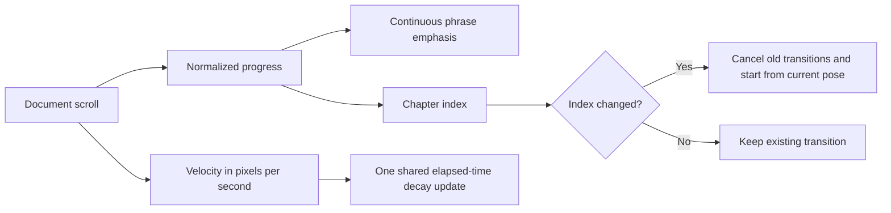

# Lesson 3 — Text progress, chapter state and velocity

**20 November 2026 · Asia/Tehran.** Documentation and independently written exercises, following [Lesson 2](02-sticky-and-scroll-progress.md). References: [Manifesto word lighting](https://animorio.com/en/animations/manifesto-that-lights-up-word-by-word-on-scroll/), [Chapters swapping askew](https://animorio.com/en/animations/chapters-that-swap-askew-on-scroll/) and [Scroll-accelerated marquee](https://animorio.com/en/animations/marquee-speeds-up-with-scroll/). The reviewed source versions and their limits remain in [SOURCE-REVIEW.md](SOURCE-REVIEW.md) and [evidence.json](evidence.json). No reference implementation or artwork is redistributed.

## 1. Three inputs with different meanings

| Input           | Unit          | Appropriate use                                | What happens when scrolling stops?               |
| --------------- | ------------- | ---------------------------------------------- | ------------------------------------------------ |
| Progress        | 0–1           | Scrub a highlight or timeline                  | Output stops, except intentional scrub smoothing |
| Chapter index   | Integer       | Start a transition only when selection changes | Timed transition can finish                      |
| Scroll velocity | CSS px/second | Increase speed, then decay                     | Extra speed fades toward zero                    |

The manifesto's words overlap on one scrubbed timeline. The chapter reference converts progress to an index, starts entry/exit timelines at boundaries, and separately applies continuous drift. The marquee uses velocity, not chapter progress. Confusing these inputs causes unnecessary animation restarts and refresh-rate-dependent motion.



```js
function textProgress(position, start, travel) {
  if (![position, start, travel].every(Number.isFinite) || travel <= 0)
    return 0;
  return Math.max(0, Math.min(1, (position - start) / travel));
}

function chapterIndex(progress, count) {
  if (!Number.isFinite(progress) || !Number.isInteger(count) || count < 1)
    throw new RangeError("Finite progress and positive chapter count required");
  return Math.min(count - 1, Math.floor(Math.max(0, progress) * count));
}

function phraseProgress(progress, index, count, overlap = 2) {
  if (
    !Number.isFinite(progress) ||
    !Number.isInteger(count) ||
    count < 1 ||
    !Number.isInteger(index) ||
    index < 0 ||
    index >= count ||
    !Number.isFinite(overlap) ||
    overlap <= 0
  )
    throw new RangeError("Invalid phrase timing");
  const p = Math.max(0, Math.min(1, progress));
  return Math.max(
    0,
    Math.min(1, (p * (count - 1 + overlap) - index) / overlap),
  );
}

function decayVelocity(velocity, seconds, halfLife = 0.18) {
  if (
    ![velocity, seconds, halfLife].every(Number.isFinite) ||
    seconds < 0 ||
    halfLife <= 0
  )
    throw new RangeError("Invalid velocity decay");
  return velocity * 2 ** (-seconds / halfLife);
}

function repeatCopies(unitWidth, viewportWidth) {
  if (
    ![unitWidth, viewportWidth].every(Number.isFinite) ||
    unitWidth <= 0 ||
    viewportWidth < 0
  )
    throw new RangeError("Measure a positive repeat unit first");
  return Math.ceil(viewportWidth / unitWidth) + 1;
}
```

At progress 1, the chapter must be the final valid index, not `count`. The phrase timing includes a tail so the last phrase reaches full emphasis at progress 1. At progress 0 every phrase is unaccented, but the text itself remains fully readable.

`overlap=2` gives a two-phrase activation window. It describes timeline overlap, not pixels or seconds. If adding a time-smoothed scrub later, give that smoothing a separate state variable and explain the lag it introduces.

## 2. Typography is geometry and language

Changing font weight can change glyph widths and line breaks. The reference reserves room with an invisible heavier copy in a grid cell. That is an implementation choice to evaluate with the actual font; the heaviest weight does not universally have the maximum width across every variable-font axis or font.

For a future variable-font lesson: load the actual face, measure the required weight/width-axis states at the current size, reserve the maximum relevant width, and remeasure after font loading, resizing or content changes. Do not silently add duplicate spoken words through generated content. Keep any measuring copies out of the accessibility tree and clipboard selection. Changes to weight, blur and clipping can affect layout or paint; this lesson makes no performance claim about them.

The original exercise below instead emphasizes **author-defined phrases with a background underline**. It changes neither opacity nor glyph metrics. No DOM text splitting or font replacement is required. Native selection and the original whitespace remain intact.

Persian text is authored as a complete phrase with `lang="fa"` and `dir="rtl"`. Splitting connected Persian letters into independently transformed spans can break shaping and joining. Grapheme segmentation prevents some broken Unicode sequences but does not, by itself, preserve shaping across element boundaries. Use whole phrases or an explicitly designed script-aware treatment. The automated check here verifies text/attributes/selection, not typographic quality or assistive pronunciation.

## 3. A readable baseline and a decorative preview

The transcript is the authoritative content and remains in normal document flow. Its heading links work without JavaScript. The optional sticky preview duplicates only the headings, is `aria-hidden`, has no interactive descendants, and cannot receive focus. It is a motion exercise, not a second reading interface. Reduced motion removes the preview and its spacer; all transcript chapters remain available.

```html
<section class="text-study">
  <h2>How a project develops</h2>
  <div class="phrase-stage">
    <p class="study-manifesto">
      <span data-phrase>Think clearly.</span>
      <span data-phrase>Build carefully.</span>
      <span data-phrase>Share the evidence.</span>
    </p>
    <p lang="fa" dir="rtl">
      <span data-phrase>با دقت فکر کن و تجربه‌هایت را به اشتراک بگذار.</span>
    </p>
  </div>
  <nav aria-label="Project chapters">
    <a href="#chapter-question">Question</a>
    <a href="#chapter-experiment">Experiment</a>
    <a href="#chapter-result">Result</a>
  </nav>
  <div class="chapter-run" hidden aria-hidden="true">
    <div class="chapter-preview"></div>
  </div>
  <div class="chapter-transcript">
    <article id="chapter-question" tabindex="-1">
      <h3>Question</h3>
      <p>State the problem and the evidence needed to understand it.</p>
    </article>
    <article id="chapter-experiment" tabindex="-1">
      <h3>Experiment</h3>
      <p>Try a focused approach and record the decisions.</p>
    </article>
    <article id="chapter-result" tabindex="-1">
      <h3>Result</h3>
      <p>Explain what changed and what remains uncertain.</p>
    </article>
  </div>
</section>
```

```css
.text-study {
  color: #1c2b39;
  background: #fff;
}
.text-study.has-preview .phrase-stage {
  position: sticky;
  top: 0;
  z-index: 1;
  background: #fff;
}
.phrase-stage {
  display: flow-root;
}
[data-phrase] {
  background: linear-gradient(#b6dce6, #b6dce6) 0 100% / var(--fill, 100%)
    0.22em no-repeat;
}
[dir="rtl"] [data-phrase] {
  background-position-x: 100%;
}
.chapter-preview {
  position: sticky;
  top: 24px;
  box-sizing: border-box;
  height: 240px;
  display: grid;
  place-items: center;
  overflow: clip;
  background: #edf2f6;
  pointer-events: none;
  user-select: none;
}
.chapter-preview > span {
  grid-area: 1 / 1;
  font: 700 clamp(24px, 5vw, 56px) / 1.2 system-ui;
  padding: 16px;
}
.chapter-transcript article {
  padding-block: 32px;
  scroll-margin-top: 24px;
}
.text-study a:focus-visible {
  outline: 3px solid #1765ad;
  outline-offset: 3px;
}
@media (prefers-reduced-motion: reduce) {
  .chapter-run {
    display: none;
  }
  .text-study.has-preview .phrase-stage {
    position: static;
  }
  [data-phrase] {
    background-size: 100% 0.22em;
  }
}
```

The default highlight is complete, so delayed or unavailable JavaScript cannot leave text visually unfinished. Normal motion supplies `--fill`; the reduced-motion rule supplies a readable immediate fallback before the media-query listener runs. Neutral styles explain the mechanism, not a proposed portfolio design.

## 4. Interrupt transitions without stale completion writes

The controller uses native Web Animations. On a chapter change it first snapshots every current visual pose, then cancels previous animations, writes the new final styles, and animates from the snapshot to those final styles. Therefore cancellation never depends on an old completion callback to establish the current chapter.

| Event                                    | Policy                                                                                        |
| ---------------------------------------- | --------------------------------------------------------------------------------------------- |
| Progress changes inside the same chapter | Update phrase emphasis; do not restart chapter animation                                      |
| Cross one or multiple chapter thresholds | Latest selected chapter wins immediately; skip intermediate chapters if necessary             |
| Reverse during a transition              | Snapshot the current visible pose; cancel and animate toward the new destination              |
| Old animation finishes after replacement | It cannot commit state; bookkeeping checks animation identity                                 |
| Motion preference changes                | Cancel all preview animations, remeasure and render immediately                               |
| Resize or new fonts                      | Refresh geometry, not the DOM text                                                            |
| Native heading link activated            | Follow the original destination; never intercept the click                                    |
| Destroy                                  | Cancel RAF and animations, remove generated preview nodes and restore owned styles/attributes |

```js
function mountTextStudy(root) {
  const run = root.querySelector(".chapter-run");
  const preview = root.querySelector(".chapter-preview");
  const phraseStage = root.querySelector(".phrase-stage");
  const articles = [...root.querySelectorAll(".chapter-transcript article")];
  const links = [...root.querySelectorAll("nav a")];
  const phrases = [...root.querySelectorAll("[data-phrase]")];
  if (!articles.length || links.length !== articles.length)
    throw new Error("One link per chapter required");
  const motion = matchMedia("(prefers-reduced-motion: reduce)");
  const events = new AbortController();
  const original = {
    hidden: run.hidden,
    height: run.style.height,
    top: preview.style.top,
    active: root.getAttribute("data-active"),
    current: links.map((el) => el.getAttribute("aria-current")),
    fills: phrases.map((el) => [
      el.style.getPropertyValue("--fill"),
      el.style.getPropertyPriority("--fill"),
    ]),
  };
  const panels = articles.map((article) => {
    const panel = document.createElement("span");
    panel.textContent = article.querySelector("h3").textContent;
    panel.style.opacity = "0";
    preview.appendChild(panel);
    return panel;
  });
  const animations = new Map();
  let selected = -1,
    frame = null,
    dirty = true,
    disposed = false;
  let start = 0,
    travel = 0,
    enabled = false;

  function cancel() {
    for (const animation of animations.values()) {
      animation.onfinish = null;
      animation.cancel();
    }
    animations.clear();
  }
  function select(index, immediate = false) {
    if (index === selected && !immediate) return;
    const poses = panels.map((panel) => {
      const style = getComputedStyle(panel);
      return { opacity: style.opacity, transform: style.transform };
    });
    cancel();
    selected = index;
    root.dataset.active = String(index);
    panels.forEach((panel, i) => {
      const final = {
        opacity: i === index ? "1" : "0",
        transform: i === index ? "translateY(0px)" : "translateY(-12px)",
      };
      Object.assign(panel.style, final);
      if (immediate || !enabled) return;
      const animation = panel.animate([poses[i], final], {
        duration: 320,
        easing: "cubic-bezier(.2,.7,.3,1)",
      });
      animations.set(panel, animation);
      animation.onfinish = () => {
        if (animations.get(panel) === animation) animations.delete(panel);
      };
    });
  }
  function measure() {
    const inset = phraseStage.getBoundingClientRect().height + 24;
    enabled =
      !motion.matches &&
      innerHeight > inset + 260 &&
      typeof preview.animate === "function";
    root.classList.toggle("has-preview", enabled);
    preview.style.top = `${inset}px`;
    run.hidden = !enabled;
    travel = enabled ? articles.length * 400 : 0;
    const height = enabled
      ? `${preview.getBoundingClientRect().height + travel}px`
      : original.height;
    if (run.style.height !== height) run.style.height = height;
    start = run.getBoundingClientRect().top + scrollY - inset;
  }
  function render(immediate = false) {
    const progress = enabled ? textProgress(scrollY, start, travel) : 1;
    phrases.forEach((phrase, i) =>
      phrase.style.setProperty(
        "--fill",
        `${phraseProgress(progress, i, phrases.length) * 100}%`,
      ),
    );
    select(chapterIndex(progress, articles.length), immediate);
    links.forEach((link, i) => {
      if (
        enabled &&
        scrollY >= start &&
        scrollY <= start + travel &&
        i === selected
      )
        link.setAttribute("aria-current", "step");
      else link.removeAttribute("aria-current");
    });
  }
  function schedule() {
    if (disposed || frame !== null) return;
    frame = requestAnimationFrame(() => {
      frame = null;
      const immediate = dirty;
      if (dirty) {
        dirty = false;
        measure();
      }
      render(immediate);
    });
  }
  function refresh() {
    dirty = true;
    schedule();
  }
  function listen(owner, type, callback, options = {}) {
    owner.addEventListener(type, callback, {
      ...options,
      signal: events.signal,
    });
  }
  listen(window, "scroll", schedule, { passive: true });
  listen(window, "resize", refresh);
  listen(motion, "change", () => {
    cancel();
    refresh();
  });
  listen(document.fonts, "loadingdone", refresh);
  const observer = new ResizeObserver(refresh);
  for (const element of [document.body, preview, phraseStage])
    observer.observe(element);
  document.fonts.ready.then(() => {
    if (!disposed) refresh();
  });
  refresh();
  return {
    refresh,
    destroy() {
      if (disposed) return;
      disposed = true;
      events.abort();
      observer.disconnect();
      cancel();
      if (frame !== null) cancelAnimationFrame(frame);
      frame = null;
      panels.forEach((panel) => panel.remove());
      root.classList.remove("has-preview");
      preview.style.top = original.top;
      run.hidden = original.hidden;
      run.style.height = original.height;
      if (original.active === null) root.removeAttribute("data-active");
      else root.setAttribute("data-active", original.active);
      links.forEach((link, i) => {
        if (original.current[i] === null) link.removeAttribute("aria-current");
        else link.setAttribute("aria-current", original.current[i]);
      });
      phrases.forEach((phrase, i) => {
        const [value, priority] = original.fills[i];
        if (value) phrase.style.setProperty("--fill", value, priority);
        else phrase.style.removeProperty("--fill");
      });
    },
  };
}
```

Load both JavaScript blocks in order, then call `mountTextStudy(root)` after the fixture exists. One controller owns the initially empty preview, initially absent `has-preview` class, preview inset, run height, phrase fill properties and link `aria-current` attributes. Destroy before remounting or replacing transcript items. The visible text is never rewritten; generated headings are removed on teardown. The phrase stage stays readable above the preview, whose inset is measured from the phrase stage's height.

The first render and refreshes snap to the current state. Ordinary threshold crossings animate. Writing final styles before starting Web Animations avoids `fill: forwards` retaining finished animation objects. No rejected `animation.finished` promise is left unhandled: cancellation and completion use explicit handles. The identity check prevents an old animation's callback from deleting the new handle for the same panel.

Geometry is measured on refresh. Scroll updates read `scrollY`, write highlight sizes and select a chapter; they do not re-read layout unless a chapter change requires a computed-style snapshot. Body resizing catches many upstream shifts; call `refresh()` after other positional changes. This example assumes a window scroller and untransformed ancestors. Long localized preview headings need a separate fitting policy; the transcript remains the complete readable fallback.

The preview spacer collapses when motion is disabled or the viewport is too short. That can change document position; preserving a selected chapter across layout modes is later integration work. The links indicate the current preview step only while scrolling inside the preview interval; once reading the transcript, that indication clears. The preview is not a route, live region or focus manager. Nothing moves keyboard focus during scroll.

## 5. Velocity-driven marquees: correct the time model first

The reviewed marquee multiplies some values by fixed decay factors on each ticker callback. It also decays shared scroll velocity inside each strip's callback. That makes behavior depend on refresh rate and the number of strips. A displacement calculation using `velocity * dt` does not fix other frame-dependent terms.

In an original implementation, estimate scroll velocity from position delta divided by elapsed seconds, then update a **single shared** velocity state per animation frame. Distribute its value to all strips. Use `decayVelocity` for idle decay. With a fixed starting velocity, a half-life of 0.18 seconds leaves half the value after 0.18 seconds at 30, 60 or 120 updates per second. Input sampling still varies across devices; this is not a promise of identical interactive trajectories.

Integrate displacement in pixels, wrap using one repeat-unit width, and remeasure after fonts or viewport changes. `repeatCopies` gives the total copies needed to cover a viewport plus one repeat-unit translation for a contiguous unit with no gap between copies. For 250 px units and a 900 px viewport it returns five. If a gap belongs to the pattern, include that gap in the measured unit. Decorative copies must not duplicate focus targets or spoken text. A zero-width unit should defer setup; never use it in an unbounded clone loop.

This lesson tests the decay and coverage mathematics. It does not implement a draggable marquee or claim browser validation of its clone lifecycle. That remains a separate exercise, including pause controls for continuous motion, pointer cancellation and resize/refill behavior.

## Verification and completion scope

Run `node docs/animation-learning/animorio/verify-text-lesson.cjs`; add `--browser` for the extracted in-memory fixture and `--record` to update [text-lesson-validation.json](text-lesson-validation.json). No website or external fonts/assets are served.

The checks cover helper endpoints, phrase overlap, refresh-rate-independent decay, repeat coverage, rapid multi-chapter changes and reversal, transition completion after scrolling stops, no restart within the same chapter, live reduced motion, native heading navigation, unchanged/selectable text, Persian direction attributes and cleanup. Browser results apply to Chromium and emulated mobile, not physical devices, screen readers or measured rendering performance.

Phase 3's text/chapter exercise and velocity mathematics are documented and verified within that scope. Variable-font rendering, Persian visual shaping and a complete marquee component are not certified by these checks. Next: navigation state and SVG reveals, where focus, scroll locking and interrupted open/close transitions must agree.
