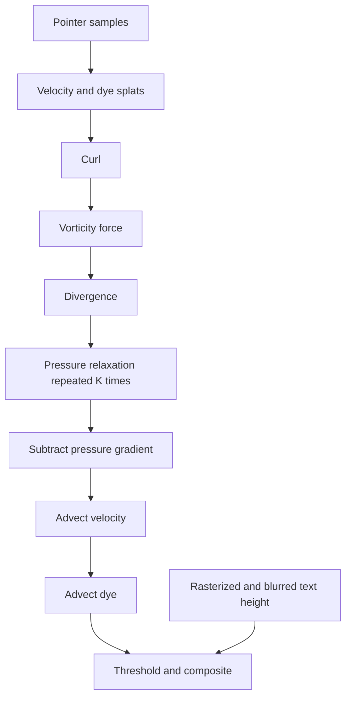
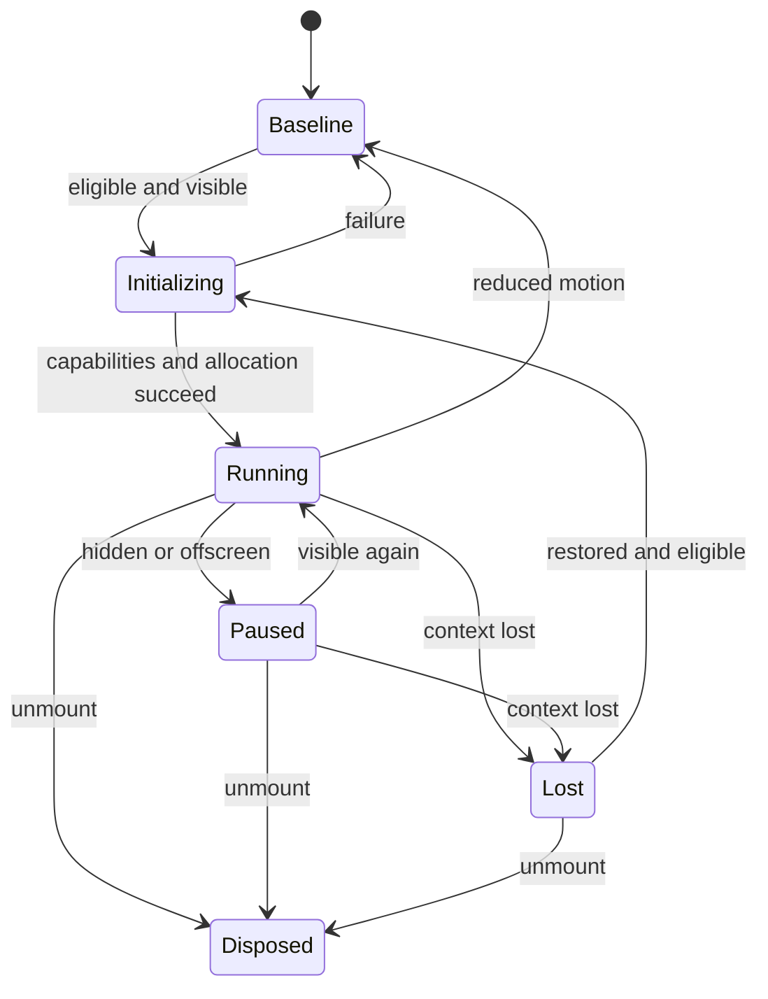

# Lesson 5 — Rendering passes, memory and fallbacks

**23 November 2026 · Asia/Tehran.** An original engineering lesson based on the previously reviewed [Ink reveal](https://animorio.com/en/animations/ink-that-reveals/). [Evidence](evidence.json) records the captured source hashes; [the source review](SOURCE-REVIEW.md) explains its implementation. No Animorio shaders, assets or simulation code are reproduced here.

## Follow the data through the frame

The reference uses raw WebGL2. Pointer samples inject both velocity and dye. Velocity transports the dye; pressure projection reduces divergence in the velocity field. A separate text height texture supplies approximate normals for metallic lighting. The inflated lettering is a height-map shading effect, not evidence of a 3D text mesh.



Pressure also has a warm-start scaling pass before relaxation. Each splat performs two draws: one into velocity and one into dye. In the inspected source, with vorticity enabled, a frame uses **K + 8 + 2S draws**, where K is the pressure iteration count and S is the number of queued splats. This counts draw calls, not equal-cost work: dye, simulation and screen targets have different resolutions. Font rasterization and height-map rebuilding are separate CPU/upload costs.

| Field       | Targets | Role                                      |
| ----------- | ------: | ----------------------------------------- |
| Velocity    |       2 | Read old state, write updated state       |
| Pressure    |       2 | Iterate the pressure estimate             |
| Divergence  |       1 | Measure local net outflow                 |
| Curl        |       1 | Estimate rotational motion                |
| Dye         |       2 | Transport and fade the visible ink        |
| Text height |       1 | Surface normal approximation for lighting |

A pass must never sample the texture attached to its current draw framebuffer. Ping-pong swaps change which physical texture is called “read” or “write.” They do not copy pixels. After resize, newly allocated targets need initialization; old simulation history is usually discarded unless deliberately resampled.

## 1. Advection is transport; projection changes velocity

For a dye sample at position x, backtrace to `x − velocity * dt` and sample the old dye field. That transports a scalar along a velocity field. It does not, by itself, keep fluid incompressible. Projection solves an approximate pressure field and subtracts its gradient from velocity to reduce divergence. More pressure iterations improve the approximation at an additional draw cost; they do not guarantee physically exact fluid behavior.

This original one-dimensional exercise isolates transport. It uses periodic boundaries, a uniform velocity in **cells per second** and linear interpolation. It is not a fluid solver.

```js
function advectRing(values, velocity, dt) {
  if (
    !values.length ||
    !values.every(Number.isFinite) ||
    !Number.isFinite(velocity) ||
    !Number.isFinite(dt) ||
    dt < 0
  )
    throw new RangeError(
      "Finite samples, velocity and nonnegative time required",
    );
  const n = values.length;
  const wrap = (x) => ((x % n) + n) % n;
  return values.map((_, i) => {
    const origin = wrap(i - velocity * dt);
    const left = Math.floor(origin),
      fraction = origin - left;
    return values[left] * (1 - fraction) + values[(left + 1) % n] * fraction;
  });
}
```

A whole-cell translation preserves this ring's samples exactly. Fractional backtracing smooths neighboring values; repeated interpolation introduces numerical diffusion. Real two-dimensional advection additionally needs coordinate conventions, aspect-correct velocities, boundary behavior and consistent texture filtering. Do not mix CSS pixels, simulation cells and normalized texture coordinates without an explicit conversion.

## 2. Budget resolution before adding effects

The reference uses six RGBA16F targets at simulation resolution (velocity pair, pressure pair, divergence and curl), plus two RGBA16F dye targets at another resolution. RGBA16F costs eight bytes per texel in raw storage. Its text height texture uses a separate single-channel half-float allocation.

```js
function fieldSize(shortSide, aspect) {
  if (
    !Number.isInteger(shortSide) ||
    shortSide < 1 ||
    !Number.isFinite(aspect) ||
    aspect <= 0
  )
    throw new RangeError("Positive resolution and aspect required");
  return aspect >= 1
    ? [Math.round(shortSide * aspect), shortSide]
    : [shortSide, Math.round(shortSide / aspect)];
}

function fluidBudget(
  shortSide,
  dyeShortSide,
  aspect,
  pressureIterations,
  splats = 0,
) {
  if (
    !Number.isInteger(pressureIterations) ||
    pressureIterations < 0 ||
    !Number.isInteger(splats) ||
    splats < 0
  )
    throw new RangeError("Nonnegative integer pass counts required");
  const [w, h] = fieldSize(shortSide, aspect);
  const [dw, dh] = fieldSize(dyeShortSide, aspect);
  return {
    simulation: [w, h],
    dye: [dw, dh],
    fieldBytes: (6 * w * h + 2 * dw * dh) * 8,
    drawsWithVorticity: pressureIterations + 8 + 2 * splats,
  };
}
```

At a 16:9 aspect ratio, the reviewed desktop parameters (256 simulation, 512 dye, 20 pressure iterations) require **13,045,760 bytes**, about **12.44 MiB**, for those eight field textures and 28 draws with no splats. The coarse-pointer parameters (128 simulation, 384 dye, 12 iterations) require **5,597,184 bytes**, about **5.33 MiB**, and 20 draws with no splats. Ten queued splats add twenty draws to either setting.

These are calculated raw field-storage estimates, not measured GPU memory or performance. They exclude height texture, drawing buffer, programs, driver overhead and any temporary resources. Doubling both field short-side resolutions at a fixed aspect ratio quadruples this field memory. DPR affects drawing-buffer resolution separately: doubling DPR quadruples output pixels while leaving fixed-resolution simulation fields unchanged.

A practical quality experiment should vary one parameter at a time: field resolution, dye resolution, pressure iterations or DPR. Record actual frame times on the target device and inspect visual changes before choosing a setting. A coarse pointer is only a heuristic; it is not a GPU capability measurement. No device benchmark is claimed here.

## 3. Make resource ownership explicit

| Resource                      | Create / refresh                                           | Release                                                                |
| ----------------------------- | ---------------------------------------------------------- | ---------------------------------------------------------------------- |
| Shader and program            | Compile/link at renderer initialization                    | Delete shader after linking as appropriate; delete program at teardown |
| Vertex buffer and VAO         | Create once per context                                    | Delete buffer and VAO                                                  |
| Field textures / framebuffers | Create after size/capability validation; rebuild on resize | Delete replaced textures/framebuffers                                  |
| Height texture                | Rebuild after actual font/text/size changes                | Delete old texture before replacement                                  |
| RAF and pointer queue         | Run only when eligible                                     | Cancel RAF, clear queue, detach events                                 |
| Observers and timers          | Observe local stage and readiness                          | Disconnect / cancel                                                    |

If initialization fails halfway, dispose everything already allocated. Check framebuffer completeness for the **actual format and dimensions** you intend to render, not only whether `getContext()` succeeded. Handle allocation limits and failed shader compilation. Keep a readable DOM baseline available throughout initialization.

The reference pauses its continuous loop offscreen and in hidden documents and deletes old field targets on resize. Its reduced-motion branch uses a local pointer reveal instead of continuous fluid simulation. These source findings do not establish a complete component unmount or context-restoration lifecycle.

## 4. Define fallback and context state



The baseline must contain actual text and usable links. A CSS radial-mask enhancement can be optional; a readable static heading is a valid fallback. Never hide the heading while waiting indefinitely for a font, shader or extension.

On `webglcontextlost`, stop submitting draws and clear queued gestures. If supporting restoration, prevent the event's default behavior as required and recreate all context resources after `webglcontextrestored`; old GPU handles are invalid. Restore settings and geometry from CPU-owned state, not old textures. Keep a generation token so delayed font/image work cannot upload into a disposed or superseded renderer.

On reduced-motion changes, cancel the continuous loop and auto-painting behavior immediately. On visibility return, reset the clock before resuming; do not integrate the entire hidden interval in one step. Cap pointer queues to avoid a burst of hundreds of splats on return. A timestep cap trades wall-clock fidelity for stability; document that decision.

## Verification and completion boundary

Run `node docs/animation-learning/animorio/verify-rendering-lesson.cjs`. It executes the Markdown snippets and checks transport direction, periodic wrapping, fractional interpolation, invalid geometry, reference-resolution budgets, pass counts and the quadratic memory cost of doubling resolution.

This completes the pass-graph, budgeting and transport exercise. It does not implement or browser-validate a WebGL renderer. Phase 5's WebGL-unavailable, reduced-motion, context-loss and real-device gates remain pending. The follow-up [browser renderer exercise](05-browser-renderer.md) now tests a static triangle, readable fallback, reduced motion, context restoration and disposal. A moving renderer and real-device quality experiment remain required before completing the phase.
