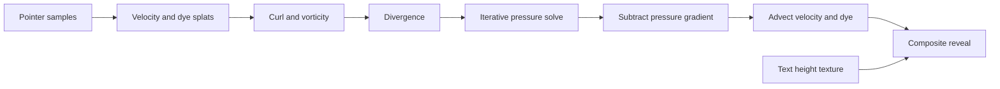

# Ten source-level reviews

Read alongside [evidence.json](evidence.json), which identifies each public source URL and captured file hash. These are independent explanations of the standalone implementations, not copied code or reviewed React/Vue adapters. Library versions observed in sampled markup include GSAP/ScrollTrigger **3.15.0** and, where included, Lenis **1.3.26**. Dependencies are not proof that every API is used.

“Integration questions” below identify work needed before reuse, not bugs established by a comprehensive audit. Browser observations are limited to [BROWSER-CHECKS.md](BROWSER-CHECKS.md).

## 1. Magnetic button — stable geometry, layered response

[Reference](https://animorio.com/en/animations/magnetic-button/) · Phase 1 · HTML layers, CSS effects, GSAP ticker and tweens.

**Mechanism.** An outer wrapper supplies stable bounds; an inner body and its label move by different fractions of pointer displacement. Targets are updated from pointer events, while the ticker moves current values toward those targets. The follower uses exponential elapsed-time damping, with a capped timestep. Release changes to an elastic return tween. A radial glow, press scale and ripple contribute separate feedback; the circular text ring changes speed.

**Why it matters.** A convincing hover interaction is several small responses sharing one input, rather than one large translation. Stable measurement avoids the pointer chasing a target displaced by its own animation. The label and body need separate transform owners.

**Source details.** Pull and label displacement use different strengths; smaller pills reduce the pull. Magnetic movement is mouse-specific, while touch gets press feedback. Keyboard Enter and focus visibility are addressed. The inspected links are placeholders and their default navigation is prevented.

**Integration questions.** The standalone ticker/listeners need disposal when used in a routed app. The reduced-motion preference is captured at initialization; changing the OS preference later requires additional handling. A reduced-motion branch can disable visible displacement while still leaving update work running. Do not assume that “motion off” also means “no ticker.”

## 2. Projects with elastic lines — spring state and SVG

[Reference](https://animorio.com/en/animations/projects-with-elastic-lines/) · Phase 1 · CSS layout, JavaScript spring integration, SVG quadratic curves.

**Mechanism.** A title is divided into two halves that move apart to expose an image. Measurements use untransformed layout offsets. Each horizontal SVG line bends through a quadratic control point near the pointer. When the pointer moves too far away, the line releases with velocity and springs toward its baseline. Small simulation substeps keep the integration stable during slower frames; the outer timestep is capped.

**Why it matters.** The interesting distinction is a physical state `(position, velocity)` versus a simple interpolation toward a target. Retaining release velocity gives a spring continuity that restarting a decorative bounce would lack. Normalized SVG path length also simplifies draw progress.

**Source details.** Fonts and resize trigger measurement. Mouse hover, focus and touch toggle paths exist. The catalog tags this implementation `css`, yet its script is approximately 7.5 KB and contains its own requestAnimationFrame loop. An optional GSAP compatibility branch does not make GSAP the core physics engine.

**Integration questions.** The standalone page disables overflow and the list uses `touch-action: none`; that choice would need changing for a vertically scrolling portfolio. Cached viewport rectangles need invalidation when a surrounding page scrolls. All row clicks prevent default navigation. Reduced motion is sampled once; rendering work continues. These details must be redesigned before the list becomes real project navigation.

## 3. Stacking cards — sticky layout plus scroll-linked decoration

[Reference](https://animorio.com/en/animations/stacking-cards/) · Phase 2 · CSS sticky, GSAP and ScrollTrigger.

**Mechanism.** The browser sticks each card at an increasing top offset. Stationary anchor elements provide scroll measurements. The next anchor drives the previous card's scale, slight alternating rotation and darkening overlay. Separate SVG timelines draw illustrations as cards enter and reverse when leaving backward.

**Why it matters.** JavaScript does not need to own the pin. CSS establishes the stack, ScrollTrigger controls decoration, and measurement anchors stay outside the transformed geometry. This division is simpler to reason about than measuring the card after scaling it.

**Source details.** The previous card approaches scale 0.93 and overlay opacity 0.38. Scroll-linked transforms use linear easing with scrub. The reduced-motion branch skips those animated transforms and draw triggers, while sticky positioning remains part of layout.

**Integration questions.** Responsive top offsets are read during initialization; refresh logic needs to re-read them if CSS breakpoints alter the geometry. Short viewports, zoom and long translated copy can exceed a fixed card's available height. Browser checks observed sticky cards and changing transforms on desktop, and no card transforms in the combined mobile/reduced configuration.

## 4. Reportage horizontal gallery — one progress value, several outputs

[Reference](https://animorio.com/en/animations/reportage-horizontal-gallery/) · Phase 2 · CSS sticky, ScrollTrigger, optional Lenis integration.

**Mechanism.** A tall vertical section contains a sticky viewport. One scrubbed progress value moves the horizontal track. Item widths, offsets and centers are measured ahead of updates; each item's distance from the viewport center controls emphasis, saturation and inner-image parallax. An oversize image provides room for that parallax without exposing an empty edge.

**Why it matters.** Several visual outputs can remain coherent when derived from one state value. The travel distance here ends by centering the final image; that is a different requirement from aligning the right edge of a generic overflowing track. Copying a familiar `scrollWidth - clientWidth` formula would change the composition.

**Source details.** The measured update avoids layout reads on each animation frame. Image/font readiness and resize lead to refresh. The optional Lenis integration feeds its animation clock from the GSAP ticker. Reduced motion changes the gallery to a native horizontally scrollable strip and removes the sticky stage; it is a structural fallback, not just a shorter duration.

**Integration questions.** Native overflow needs keyboard access and clear discoverability when scrollbars are hidden. A global smooth-scroll instance should have one owner across the application. Explicitly test the first/last items, reverse travel, viewport resizing, browser history and dynamic content. Images and font rights are separate from understanding the motion algorithm.

## 5. Manifesto word lighting — text metrics are part of the animation

[Reference](https://animorio.com/en/animations/manifesto-that-lights-up-word-by-word-on-scroll/) · Phase 3 · DOM text wrapping, CSS grid, variable font and GSAP timeline.

**Mechanism.** Text nodes become word wrappers while preserving whitespace. A paused timeline gives neighboring words overlapping active intervals. Each word changes color, weight, blur and a small vertical displacement. Special inline content and the signature have separate timing. A tall containing section and sticky stage map reading distance to the timeline through ScrollTrigger.

**Why it matters.** Animating weight can change word width. A hidden heavier copy in the same CSS grid cell reserves the maximum width so the visible word can change weight with less line reflow. This is a layout technique, not something a tween library solves automatically.

**Source details.** The CSS `::after` content uses the word's `data-t` text and a heavier weight while remaining invisible. The reduced branch fully lights the text and shortens the section, avoiding Lenis and the scroll trigger. The normal optional Lenis bridge converts GSAP ticker seconds to milliseconds; it also changes global ticker lag smoothing.

**Integration questions.** Weight and blur can incur substantial rendering work; no performance benchmark was performed. Preserve semantic text and test copy/paste and assistive reading after splitting. Recalculate when fonts, content or width change. Persian shaping requires its own text treatment rather than mechanically copying Latin letter-splitting techniques.

## 6. Chapters swapping askew — thresholds plus continuous drift

[Reference](https://animorio.com/en/animations/chapters-that-swap-askew-on-scroll/) · Phase 3 · sticky stage, GSAP state transitions, ScrollTrigger progress.

**Mechanism.** Normalized scroll progress is multiplied by the chapter count; its integer part selects a chapter, clamped at the end. Crossing a threshold starts a timed exit/entry transition. Separately, local and global progress move and tilt the current composition. Per-chapter timelines are canceled when state changes again.

**Why it matters.** This is a hybrid interaction. Scrubbing everything would produce a different experience. Discrete chapter selection, timed transitions and continuous drift need distinct state variables and transform layers, particularly when the user reverses direction quickly.

**Source details.** The script defines a custom spring easing equation executed by GSAP. A comment comparing that equation to another library is not evidence that the library is loaded. Chapter controls scroll to chapter midpoints and update `aria-current`. Narrow layouts reduce rotational amplitude.

**Integration questions.** Reduced motion retains threshold-based chapter selection and crossfades rather than laying out all chapters in sequence. Check that each chapter remains reachable and understandable with keyboard scrolling and restored positions. Rapid threshold crossings, focus in outgoing content and teardown require dedicated testing; they are not covered by this initial browser sample.

## 7. Marquee acceleration — velocity and periodic coordinates

[Reference](https://animorio.com/en/animations/marquee-speeds-up-with-scroll/) · Phase 3 · repeated DOM content, GSAP ticker, scroll velocity, pointer capture.

**Mechanism.** Copies fill a strip wider than the viewport. Position advances in pixels per second and wraps over one repeat unit. Scroll velocity adds speed and tilt; pointer drag directly changes position and estimates release velocity. Decorative copies are hidden from the accessibility tree.

**Why it matters.** Wrapping coordinates and calculating velocity are more reusable than the particular typography. This example is also a useful code-review exercise: multiplying displacement by delta time does not automatically make the entire simulation independent of frame rate.

**Source details.** Several interpolation/decay factors are applied once per ticker callback rather than per elapsed second. A shared scroll-velocity value is decayed inside each strip's callback, so the number of strips affects decay. Resize updates the repeat width but does not refill the clone count for a substantially wider viewport.

**Integration questions.** Convert decay to elapsed-time behavior in an original implementation; update shared velocity once per frame. Refill coverage after resize/font changes. Reduced motion returns before creating per-strip ticker behavior, but cloning and the global ScrollTrigger already exist. Add cleanup and explicit lost-pointer-capture handling. Test touch vertical scrolling; the source's `pan-y` choice is a useful starting point.

## 8. Menu from its button — geometry and interaction state

[Reference](https://animorio.com/en/animations/menu-from-its-button/) · Phase 4 · circular clip-path, GSAP timelines, focus and inertness.

**Mechanism.** The reveal circle starts at the menu trigger's center. Its target radius reaches the farthest viewport corner. A mutable radius lets a replacement tween continue from the current visual state after interruption. Link text rises through masks while the trigger label/icon changes. The trigger remains above the overlay.

**Why it matters.** The reveal is straightforward geometry; the difficult part is coordinating visibility, focus, inertness and scroll locking throughout opening and closing. A beautiful overlay that traps focus or leaves scroll locked is incomplete navigation.

**Source details.** Opening clears the menu's inert state and locks page scrolling; closing restores inertness after the transition. Keyboard opening focuses the first link, Escape closes, Tab is wrapped through the trigger and menu links, and focus returns to the trigger where appropriate. Resize recalculates coverage. Reduced motion uses a crossfade. Demo destinations are placeholders.

**Integration questions.** Inertness of the closed menu is different from making the background inert while it is open. The standalone sample does not establish a complete background focus policy for a real site. Test interrupted toggles, nested overlays and navigation failure. The browser check verified keyboard opening and Escape restoration in two configurations, not the entire focus model.

## 9. Scribble reveal — a broad SVG stroke can cover a screen

[Reference](https://animorio.com/en/animations/scribble-that-reveals/) · Phase 4 · generated SVG path, stroke width/dash offset and GSAP sequencing.

**Mechanism.** A deterministic generated path meanders across the viewport. A very wide stroke initially covers it; changing dash offset and stroke width retracts that cover. The page's text entrance overlaps with the reveal. Resize rebuilds the path while retaining the current reveal progress.

**Why it matters.** A complex-looking reveal does not necessarily require Canvas or a shader. SVG geometry and careful overlap can provide an organic transition. The path is computed in viewport geometry, so preserving progress across a rebuild matters.

**Source details.** Font readiness is raced against a timeout. Split heading letters sit in an aria-hidden wrapper while the heading retains its accessible label. Replay covers the page again before repeating. Reduced motion uses a brief cover fade and hides replay.

**Integration questions.** Any full-page cover needs a failure path that exposes content if initialization or a dependency fails. Test repeated replay during an active timeline and resize while covered. The source-level review does not establish no-JavaScript or CDN-failure behavior. Intro polish should follow navigation reliability, not become a prerequisite for accessing projects.

## 10. Ink reveal — fluid fields plus height-map lighting

[Reference](https://animorio.com/en/animations/ink-that-reveals/) · Phase 5 · raw WebGL2, GLSL, Canvas text measurement, GSAP entrance.

**Mechanism.** Pointer movement injects velocity and dye into separate texture fields. Ping-pong targets ensure a pass reads one texture while writing another. The simulation computes curl/vorticity, divergence, repeated pressure relaxation, pressure-gradient subtraction and advection. Decay factors are converted to elapsed-time behavior. A final shader thresholds the dye to reveal the underlying composition.

**The metallic text is another technique.** Canvas rasterizes the text at measured letter positions. Repeated box blurs approximate a smooth height field; finite differences estimate normals, and an analytic lighting model makes it look inflated. That appearance does not require a 3D text mesh.

**Source details.** The code tests float framebuffer support. Coarse-pointer settings lower field resolution and pressure iterations; drawing-buffer DPR is capped. Resize deletes/recreates the simulation targets. Intersection and document-visibility checks pause the continuous loop. Reduced motion uses a pointer-centered reveal without ongoing fluid simulation; unavailable WebGL switches to a CSS masked duplicate.

**Integration questions.** There is no demonstrated complete unmount/context-restoration lifecycle in this standalone review. Programs, vertex resources, observers, event listeners and textures all need explicit ownership. The fallback's touch interaction also needs testing. No GPU performance, mobile hardware or context-loss browser validation was performed here; this is an advanced source study, not a production-readiness verdict.

## Incomplete source access

| Candidate                                                          | Evidence obtained                           | Remaining work                                                                                                                       |
| ------------------------------------------------------------------ | ------------------------------------------- | ------------------------------------------------------------------------------------------------------------------------------------ |
| [Melting sheet](https://animorio.com/en/animations/melting-sheet/) | Catalog metadata, detail page and demo HTML | CSS request returned HTTP 503; subsequent detail retry also failed. Read the actual implementation before classifying its mechanism. |
| [The glass word](https://animorio.com/en/animations/glass-word/)   | Catalog metadata                            | Detail requests returned HTTP 503. No implementation claim is made from its title or tags.                                           |

These two remain in the queue. The other 1,945 catalog entries have not received source-level reviews.
