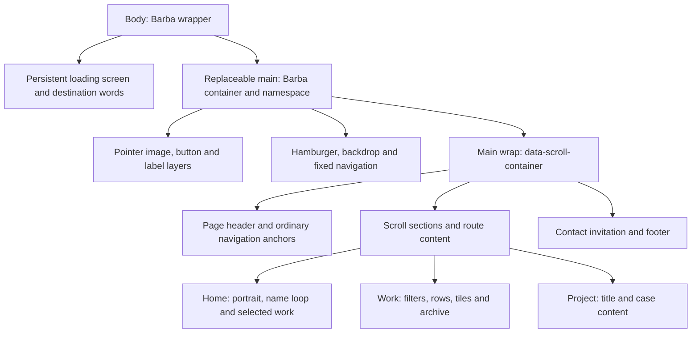
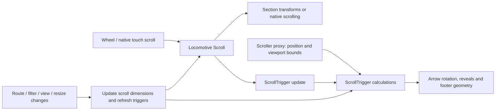
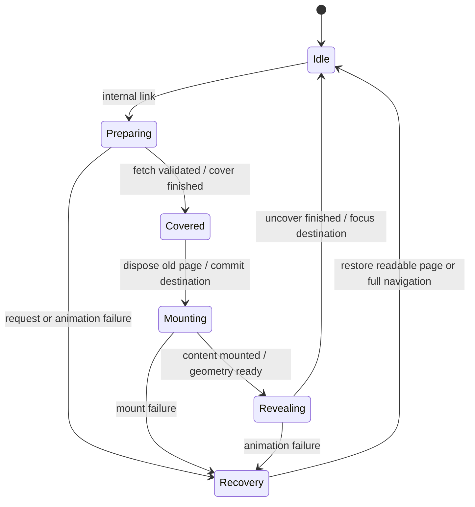

# Architecture — shared scroll coordinates and page ownership

This is a conceptual model reconstructed from Dennis Snellenberg's delivered HTML, CSS and `index-new.js` on **17 November 2026**. It does not describe private source folders or the historical 2022 build. See the [study overview](README.md) for credits and evidence boundaries.

## Structure visible in the delivered page

The persistent cover is outside the replaced `main`. Navigation and cursor elements are inside it, so those elements change with a route. A persistent document-level listener can nevertheless outlive the element it originally referenced; replacing DOM is not equivalent to disposing JavaScript.

The HTML response contains content and real links before JavaScript runs. Barba enhances internal navigation. This establishes server-delivered markup, not a particular CMS, application framework or backend language.

## Scroll coordinates

On the tested desktop, document `scrollY` stayed zero while section transforms changed. The root scroller's computed transform was `none`: inspecting only the root would miss the movement. The supplied `data-scroll-section` children are important to this implementation.

The bridge in `initSmoothScroll()` supplies a position getter/setter and viewport rectangle through `ScrollTrigger.scrollerProxy()`, forwards the scroll event to `ScrollTrigger.update()`, and updates dimensions on refresh. It sets a default scroller for subsequent triggers. Its pin strategy inspects the root's inline transform; that heuristic is source-verified, but pin correctness across devices was not exhaustively tested.

Two different calculations must remain consistent:

- **Progress update:** where the visitor is now. It can happen frequently during scrolling.
- **Geometry refresh:** where triggers start/end after layout changes. It is needed after filtering or image/font changes, not on every pointer movement.

For a new implementation, use native scrolling first. Add an adapter only if transformed scrolling provides a specific benefit. APIs and defaults vary between Locomotive generations; this older bridge is not a drop-in recipe for a current release.

## Actual transition coordination

`barba.init()` uses `sync: true`. The following table describes inspected responsibilities, **not a guaranteed serial execution order** for all hooks.

| Source location          | Responsibility seen in code                                                                             |
| ------------------------ | ------------------------------------------------------------------------------------------------------- |
| `once`                   | Create scroller, initialize interactions, restore view preference, play first-load sequence             |
| `before` hook            | Add `is-transitioning` to the document                                                                  |
| `leave` transition       | Start the covering animation, wait 495 ms, remove old container                                         |
| `enter` transition       | Start incoming content animation and obtain destination loading words from parsed next-page HTML        |
| `beforeEnter` transition | Kill existing ScrollTriggers, destroy scroller, construct the next scroller and initialize interactions |
| `enter` hook             | Also destroys the current scroller                                                                      |
| `afterEnter` hook        | Reset native scroll to top and restore Work view preference                                             |
| `after` hook             | Initialize/stop the scroller; animation callbacks also start/stop it                                    |

The covering timeline moves the screen from below the viewport to its center in 0.5 seconds, reveals the destination word, then moves it above the viewport. Rounded edge wrappers change height. The incoming content animates separately. Consequently, the route swap, covering animation and content reveal have several timing owners.

The educational improvement is explicit completion and ownership. This is a **recommended redesign**, not a transcription:

Fetch and cover can run concurrently; replacement must wait for both. During transition, serialize navigation or explicitly cancel the older request. Browser Back needs its own history/scroll-restoration policy. Every failure path must release input locks, remove overlays and provide a reachable destination.

## State model

| State             | Original evidence                                                                         | Recommendation for reuse                                                          |
| ----------------- | ----------------------------------------------------------------------------------------- | --------------------------------------------------------------------------------- |
| Route             | URL plus Barba container namespace                                                        | URL remains authoritative; preserve ordinary links and browser history            |
| Menu              | `main.nav-active` and control `.active` classes                                           | One owner for open state, focus restoration, modal behavior and scroll lock       |
| Filter            | Classes on buttons and `.visible` across row/image/tile representations                   | Derive all presentations from one filtered project array                          |
| View              | `view=rows` or `view=columns` cookie, expiry 14 days                                      | Persist only the preference; validate stored values and survive blocked storage   |
| Preview           | Pointer position, delayed layer positions and current visible row index                   | Keep pointer position separate from project identity; cancel animation on unmount |
| Scroll            | Locomotive instance plus ScrollTrigger proxy/defaults                                     | A page owns its adapter, triggers and refresh subscription                        |
| Motion preference | No `prefers-reduced-motion` match found in inspected app JS and three principal CSS files | Explicit preference policy for loaders, loops, scrolling and pointer effects      |

The filter-cookie statements in the inspected application are commented out. Do not describe category selection as persisted just because the layout preference is persisted.

## Maintenance and performance trade-offs

The code kills ScrollTriggers and destroys the scroll instance, but `initScript()` also creates document listeners, resize listeners, repeating cursor tweens and marquee timelines. Some subscriptions have no corresponding cleanup in the inspected functions. Repeated initialization is therefore a lifecycle concern. This study does **not** establish a measured memory leak or a failure after a specific number of visits.

One concrete source issue is `window.onresize = scroll.update();`: it calls `update` immediately rather than registering a callback. The scrolling library can have its own resize handling, so this alone does not prove visible resize failure.

The cursor updates `left` and `top`; cover animations use `top` and edge `height`; reveal CSS changes `width`. These properties can entail more layout/paint work than transform-only movement. That is a cost to profile, not evidence of poor frame rate. Limit motion to visible/active elements and stop repeating work when the owning page disappears. Use separate wrappers when position, scale and image-strip movement each need transforms.

No CPU/GPU, memory, network-performance or Core Web Vitals benchmark was performed. The browser's request routing changed delivery timing, and emulation is not a physical-device test.
