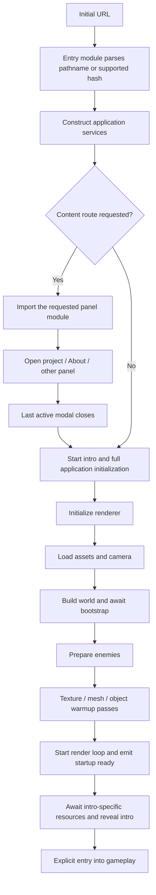
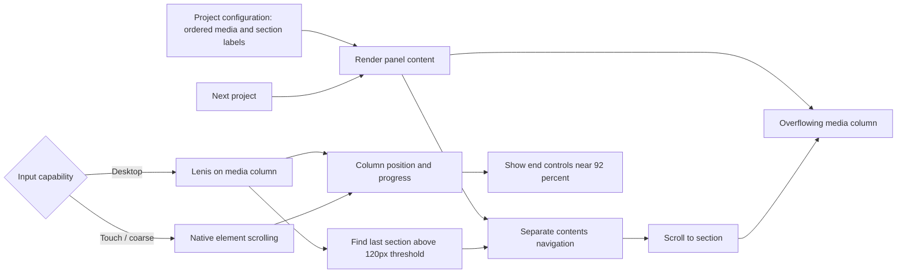
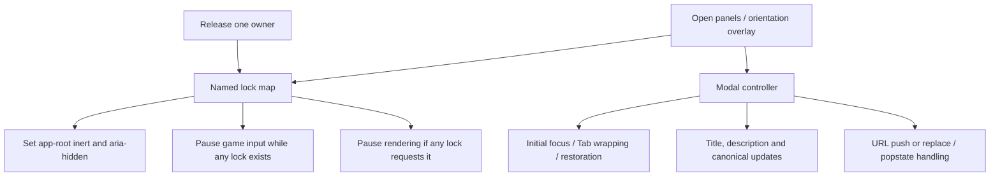

# Architecture — a 3D world with independently readable project panels

This is a reconstruction of publicly delivered modules on **17 November 2026**, not a description of private source directories. See [README.md](README.md) for creator credits and investigation limits; [evidence.json](evidence.json) maps the hashed module names to their inspected responsibilities.

## Two entry paths

The application object exists on either path, but `app.init()` is deferred for a direct content URL until the modal set becomes empty. A direct project visit still imports application/library code and creates services; it is **not** a zero-cost static route. It does, however, avoid making a reader complete the game to see a project. Direct Hanzii and About rendering succeeded in the browser investigation.

The renderer class comes from Three's WebGPU-oriented bundle, but the inspected constructor supplies `forceWebGL: true`. The canvas label `three.js r183 webgpu` is therefore not reliable evidence of the active graphics backend. Distinguish library packaging, renderer configuration and runtime capability.

Startup progress is weighted by stages, not transferred bytes: renderer completion is configured at 0.05, asset loading at 0.5, camera at 0.55, world at 0.58 and enemies at 0.6; warmup occupies the remainder. Progress never decreases. Warmup yields via `scheduler.yield()` where available or a timer fallback. An apparently complete asset download does not prove that scene construction, physics or GPU preparation has finished.

## Content and scroll ownership

The document itself is fixed and non-scrolling. Desktop case studies install Lenis on `.case-study-page__images-column`, with `.case-study-page__images-wrapper` as content. GSAP's ticker supplies seconds; the callback multiplies by 1,000 before calling Lenis's millisecond `raf` API. The sidebar's contents list is a **second** scroll container.

The desktop active-section calculation compares each media wrapper's top with the media column's top. The last section within a 120 px threshold wins. It updates the matching item's class and `aria-current`, then centers it within the contents list. The native branch updates end controls without calling the same active-TOC routine; the contents UI is hidden at the tested mobile size. Do not describe the desktop TOC tracking as verified mobile behavior.

Project configuration creates both media and TOC labels. Most narrative sections are images, with dimension/aspect-ratio declarations, responsive `<picture>` sources and lazy loading after the first two images. These choices preserve visual layout, but image-contained body text cannot reflow like HTML paragraphs.

## Modal and game boundaries

Input and rendering are separate concerns: a small overlay may need input isolation without stopping every visual. The source uses keyed locks, an active-modal set and lifecycle events. It also tracks cleanup functions for DOM listeners, event-bus subscriptions, timers and created elements. The modal controller has explicit animation cancellation/finalization and restores focus selectively.

Do not infer full accessibility from `aria-modal`. The bounded About test verified that focus entered the panel and a Tab press reached a skill tab. Complete focus order, focus trapping across all panels and screen-reader behavior were not audited.

## Simulation and presentation clocks

The inspected world module initializes Rapier physics and uses a 1/60-second fixed timestep. Each visual frame contributes elapsed time to an accumulator; the loop executes at most five physics steps, records previous transforms and computes interpolation alpha. It also resets accumulated time around intro transitions. The application's general frame clock separately caps its delta at 60 ms.

This separates simulation consistency from display refresh rate. The visual transform can interpolate between previous/current physics states while input and collision changes happen at fixed steps. The source's grab interaction additionally changes body properties and restores relevant state on release/respawn. These are **source findings**; a successful live grab/throw interaction was not established by this study.

## History and lifecycle trade-offs

Project switching destroys the old Lenis instance/ticker callback, renders new media, updates metadata and pushes the project URL. The generic modal's `popstate` listener closes the open modal rather than resolving the destination project. In the captured Hanzii → Niubii → Back sequence, the URL returned to Hanzii but the project panel closed. This is a concrete mismatch between route state and visible content in that tested sequence.

A stronger route owner should parse the destination URL on **every** history traversal, select the matching project, and render it without another push. Only transitions to the world route should close the project panel. Preserve scroll state separately for each history entry, and decide explicitly whether a new project begins at its top.

Panel construction and project replacement also have different lifetimes. The source's disposable registry is useful, but project switches bind fresh listeners/subscriptions. A recommended implementation has a nested scope for the current project and disposes it before rendering the next one, even when the outer modal survives. This is a maintenance recommendation, not a measured leak finding.
