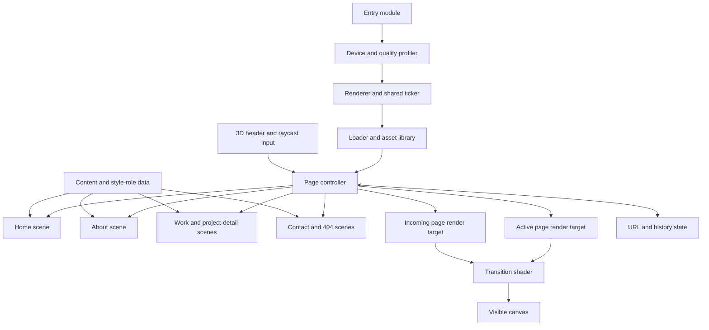
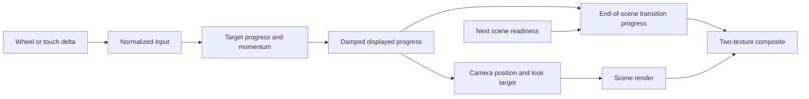
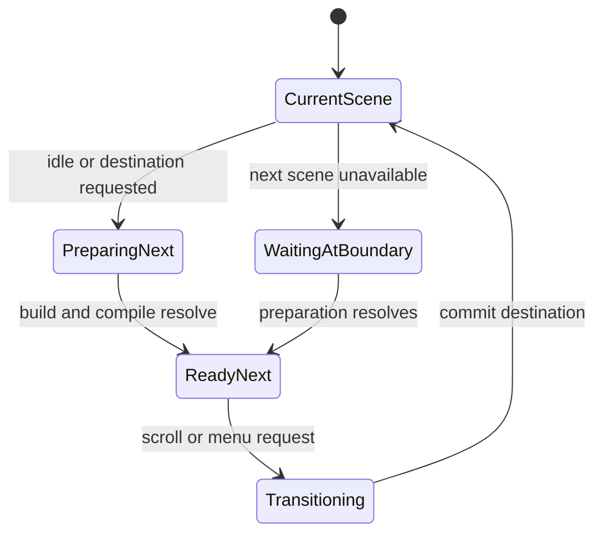

# Architecture — source-backed model and recommended boundaries

This accompanies the independent [Sztanki case study](README.md). **Verified** means found in delivered code. Diagrams use explanatory names for those responsibilities, not original private filenames. **Recommended** sections describe our own implementation choices.

## Application structure

The entry document contains a fixed graphics host. The application initializes a device profiler, renderer, scene/camera infrastructure, assets and loader. Initial page preparation precedes the main header and router setup.

**Verified:** each page receives a virtual stage with a cloned camera. The controller connects two render-target textures to a full-screen transition material. During a transition, it activates the outgoing and incoming virtual stages. Inactive stages can remain cached; stopping their rendering does not imply releasing their memory.

The header is another 3D component. It measures label geometry, lays out a row, builds separators and a panel, and maps viewport dimensions into world-space position. Project-detail state substitutes a close control for the normal menu. Pointer events pass through a raycaster/registry rather than native anchor dispatch.

## Rendering and scrolling model

**Verified:** the stylesheet locks document overflow and disables native touch panning. The camera controller receives wheel and pointer input. It normalizes wheel units, tracks target and displayed positions, and applies momentum and damping. On a path, it evaluates position with `getPointAt`; look direction can come from separate look points or a forward point on the curve.

This is camera scrolling, not a claim that native `scrollY` drives the experience. Mixing a DOM scroll owner and this camera controller without an explicit bridge would introduce conflicting inputs.

The transition controller derives a final-zone fraction from scene travel, capped at .4 by default. It advances the incoming camera partway while mixing scenes. Click navigation also moves relevant cameras and animates the composite with a default 1.6-second duration. Warp, swirl, RGB shift and burn are explicit shader controls. These are source parameters; no successful timing measurement was obtained.

## Readiness and navigation state

**Verified:** `preparing` stores promises, `readyPages` records prepared destinations, and `waitingFor` tracks requested pages. Building a page can include asset readiness and shader precompilation. Background preparation begins after the current scene has been quiet for approximately one second in the controller's clock. When the next page is not ready, progression stops at the transition boundary and a loading state is emitted.

The diagram intentionally omits a successful error recovery path: one was not established. Some asset waits race a six-second timer, but a timeout is not equivalent to successful shader compilation. Rejected preparation promises, stale destinations and renderer loss need explicit treatment in a reusable design.

**Recommended:** represent `idle`, `preparing`, `transitioning`, `failed` and `disposed` states explicitly. Keep the previous page readable during preparation, reject stale requests with a generation token, and clear a failed cached promise before retrying. Render a native link to the destination when enhanced navigation fails.

The source uses `pushState`/`replaceState`, listens for `popstate`, and recognizes `/work/<slug>/`. The Contact follow-up observed a pointer activation change the URL to `/about/` and browser Back return it to `/contact/`. The About destination did not visually commit in the sampled capture. A successful Back/Forward/reload flow is therefore not established. URL state, current scene, displayed transition and focused control must agree. A production adapter should also set a useful document title and focus a real heading after navigation.

## Content and typography architecture

**Verified:** content strings and project records are stored separately from layer configuration. Layers carry type, content key, style role, position and other scene properties. Style roles select atlas/font aliases, colors and desktop/mobile sizes. A registry connects layer types to constructors.

This enables reuse of text panels, cards and buttons across scenes. It also makes constraints explicit: line breaking, glyph availability, localization and text selection are not automatically supplied by the browser's HTML layout engine. The source's `h1`/`h2` role aliases describe visual styles; they do not create semantic heading elements.

**Recommended conceptual boundaries:**

- Content model: names, descriptions, project records, destination URLs and accessible labels.
- Presentation policy: viewport, motion preference, selected quality and input capabilities.
- Scene layer: geometry, camera paths, materials and render targets.
- Navigation owner: route, readiness, history and cancellation.
- Semantic HTML layer: readable content, headings, real links and focus management.

The semantic layer is a recommendation, not an observed component of this site.

## Quality, performance and resource ownership

**Verified:** the profiler considers renderer information, device characteristics, resolution and an optional cached benchmark. Software-renderer names map to a lower quality tier. Application pixel-ratio caps are `[2, 1.75, 1.5, 1.25]`; feature policies adjust particles and gate effects such as fluid simulation, frost and preloading. These values are source configuration, not our performance results.

Quality tiers reduce workload; they do not guarantee API, shader or storage-buffer compatibility. The browser attempts demonstrate why those decisions must be separated. Even obtaining a WebGPU adapter did not result in a usable scene in the software-rendering retry.

An illustrative memory estimate: two RGBA8 color targets at 1440×900 with DPR 2 require `2 × 1440 × 900 × 2² × 4 = 41,472,000` bytes, about 39.6 MiB, **before** depth buffers, texture assets, multisampling or other targets. This is arithmetic under stated assumptions, not measured memory use or a claim about the actual render-target format.

The inspected code contains component disposal methods, event removal, particle cleanup and render-target resizing. It also caches prepared pages. A reusable implementation needs an owner for each resource and an eviction policy for scenes whose textures are no longer needed. Shared font atlases should outlive a single card; a card must not dispose resources still used elsewhere.

## Accessibility and failure boundary

The captured DOM states contain a canvas without equivalent portfolio headings, links or buttons. The initial document also lacks a semantic content fallback. Since live initialization failed, this finding describes the observed delivery/failure state; it is not a comprehensive audit of the finished experience.

**Recommended:** keep semantic HTML available before and throughout enhancement. Use the same content model for HTML and canvas. A raycast hit and a keyboard-activated link should dispatch the same navigation intent. Decorative duplicated canvas content can be hidden from accessibility APIs only when the HTML equivalent actually exists. Reduced-motion preference should select static or direct transitions independently of GPU quality.

No private backend, CMS, framework folder structure or authoring pipeline is inferred from this conceptual model. The evidence trail is in [README.md](README.md) and [evidence.json](evidence.json).
