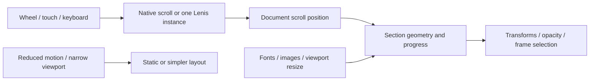

# Implementation reference for later use

Current scope: study and document mechanisms for later use. Begin with the [four individual case studies](README.md#read-one-reference-at-a-time). The earlier lab is historical, not an approved portfolio design.

The [site study](STUDY.md) explains the original implementations. The [lab](motion-lab/index.html) is an original, runnable reconstruction of shared mechanisms. The supplementary snippets here explain integration choices; they are not all independently browser-tested components.

## Separate layout, scrolling and presentation



CSS determines where content lives. A smoothing engine changes how the document reaches its target scroll position. ScrollTrigger maps that position into animation progress. A timed reveal runs after a threshold is crossed. These are separate responsibilities.

Do not combine several smooth-scroll owners. Do not create a custom scroll container unless you need one: it complicates sticky positioning, anchors, keyboard scrolling and focus. `scroll-behavior:smooth` handles anchors/programmatic scrolling; it is not a wheel interpolation engine. Scroll snap determines resting positions; it does not make an animation follow progress.

## Historical mechanism experiment

The lab includes:

| Mechanism | Find in index.html | Reference connection |
|---|---|---|
| Optional wheel smoothing | setSmooth, tick | Glinto / AW Media |
| Generated image sequence | frames, draw, playhead | Tom |
| Bottom-to-top navigation | updateNav | Tom |
| Time-based reveal | data-enter | Raha / Tom |
| Scroll-linked character opacity | scrub-text | Simplified reading progression |
| Sticky horizontal runway | horizontal, measure, distance | Glinto |
| Sticky cards with shrinking inner panels | stack-card, stack-inner | AW Media |
| Responsive teardown | gsap.matchMedia cleanup | Shared implementation requirement |

The character-opacity example is simpler than Tom's transient accent-color wave. The lab does not reproduce Tom's custom lens shader, HLS pipeline, cursor drawing or artwork. Those mechanisms are explained below and in the study as advanced extensions.

The lab generates 48 small original frames in memory. A production image sequence should load optimized licensed assets, cap decode memory, prioritize likely frames and display a poster before enhancement. Generating frames is used here to make the learning artifact self-contained.

## One shared animation clock

```js
const lenis = new Lenis({ lerp: 0.1, smoothWheel: true });
const tick = seconds => lenis.raf(seconds * 1000);
lenis.on('scroll', ScrollTrigger.update);
gsap.ticker.add(tick);

function dispose() {
  gsap.ticker.remove(tick);
  lenis.off('scroll', ScrollTrigger.update);
  lenis.destroy();
}
```

Lenis expects milliseconds; GSAP's ticker provides seconds. If GSAP owns the clock, do not also enable Lenis autoRaf. AW Media disables GSAP lag smoothing globally; the learning lab does not require that global change. Test background-tab recovery before adopting it.

`lerp` controls following behavior, not an animation's duration. Scroll smoothing and numeric `scrub` both introduce following delay; stacking strong values can make the page feel detached from input.

## Measure the right progress

```js
const clamp01 = x => Math.max(0, Math.min(1, x));
const rangeProgress = (y, start, end) =>
  clamp01((y - start) / Math.max(1, end - start));
const traversalProgress = (rect, viewportHeight) =>
  clamp01((viewportHeight - rect.top) /
    (viewportHeight + rect.height));
```

`rangeProgress` describes an explicit scroll interval. `traversalProgress` spans a section's full journey from entering at the viewport bottom to leaving at the top. Do not substitute one for the other: the same effect will have different pacing.

Read geometry together, then write styles together. Schedule work once per animation frame instead of repeatedly measuring on every raw scroll event. Use `invalidateOnRefresh` for values derived from dimensions. Refresh after actual layout changes; refreshing on every scroll defeats caching.

## Horizontal composition

Define `travel = max(track.scrollWidth - viewportWidth, 0)`. A sticky viewport sits inside a longer runway. Its height is the viewport height plus the distance allocated to horizontal travel. Glinto uses a 1.5 multiplier and supports an optional initial hold.

```css
.runway { position: relative; }
.stage { position: sticky; top: 0; height: 100svh; overflow: hidden; }
.track { display: flex; width: max-content; }
```

Translate only the track. Keep text and controls in normal accessible DOM. On narrow screens, make the cards a vertical list or a native horizontal scroller. The lab uses a vertical list. Never force a long horizontal animation onto small touch screens just to preserve a desktop composition.

## Stacked project panels

Sticky handles positioning; an inner wrapper handles scale. The next card's arrival drives the previous card's exit.

```js
const exit = gsap.timeline({
  scrollTrigger: {
    trigger: nextCard,
    start: 'top bottom',
    end: () => `top ${parseFloat(getComputedStyle(nextCard).top)}px`,
    scrub: true,
    invalidateOnRefresh: true
  }
});
exit.to(currentInner, { scale: 0.9, ease: 'none' }, 0);
exit.to(currentDim, { opacity: 0.55, ease: 'none' }, 0);
```

Do not scale the sticky element itself. Check its ancestors for overflow that changes the scroll container. Ensure the containing section is tall enough for sticky to operate. Leave the final panel readable; it has no next card to drive an exit.

## Frame sequences and cover drawing

```js
const index = Math.round(progress * (images.length - 1));
const scale = Math.max(canvas.width / image.width,
                       canvas.height / image.height);
ctx.drawImage(image,
  (canvas.width - image.width * scale) / 2,
  (canvas.height - image.height * scale) / 2,
  image.width * scale, image.height * scale);
```

Canvas CSS dimensions and backing resolution are different. Resize the backing store only when needed, cap DPR, and redraw afterward. Keep frame loading separate from render scheduling. Prefer the nearest decoded frame to a blank canvas. Use a generation counter or AbortController during source changes so stale work cannot overwrite the current sequence.

Tom's source uses a 63-frame JPG sequence, four concurrent requests and midpoint-first queue coverage. Those are study findings, not a mandate that MAK needs 63 frames. Choose count and resolution from visual quality and memory measurements.

## Text: entry versus scrubbing

For a time-based masked entrance, put the animated content inside an overflow-hidden wrapper and move it from below the wrapper to its final position. The trigger starts a timed transition; continued scrolling does not control its playback.

For reading progression, map scroll progress to character or word count. Tom's wave adds a temporary accent color as each character is crossed. A conceptual state transition is:

```js
const next = Math.round(progress * characters.length);
// Moving forward: newly crossed characters accent -> final color.
// Moving backward: characters after next return to initial color.
// Kill each character's previous color tween before replacing it.
```

Split by words before characters to preserve wrapping. Keep one accessible text label and hide decorative duplicates from assistive technology. Rebuild line masks after font loading or width changes; preserve original text during teardown. Do not split contenteditable text or controls.

## Pointer parallax and cursors

```js
const rect = hero.getBoundingClientRect();
const x = ((event.clientX - rect.left) / rect.width) * 2 - 1;
const y = ((event.clientY - rect.top) / rect.height) * 2 - 1;
```

Follow those targets with a spring or exponential interpolation. Keep pointer motion, scroll motion and layout transforms on separate wrappers. Reset to neutral on pointer leave. Enable this only for fine pointers and respect reduced motion. Raha's custom cursor also changes shape and estimates background luminance; a decorative follower that preserves the native cursor is a simpler initial implementation.

## A draggable gallery before a shader gallery

Start with semantic links in a native horizontal scroller, `scroll-snap-type:x mandatory`, keyboard-operable previous/next controls and visible focus. That remains the fallback when enhanced rendering fails.

For a custom renderer, separate input state from displayed state:

```js
target += horizontalWheelDelta * sensitivity;
display += (target - display) * follow;
velocity *= friction;
// After input settles, move target to the nearest panel center.
```

Use delta-time-normalized damping for consistent behavior across refresh rates. Preserve vertical touch panning (`touch-action:pan-y`), distinguish horizontal from vertical wheel intent, use pointer capture while dragging, and suppress link activation after meaningful movement. Tom's centered-item click and off-center-item centering are distinct actions.

Tom's glass effect additionally uses Three.js and a shader. Conceptually it samples a source texture at distorted coordinates inside an elliptical mask. Different channel sample offsets create dispersion; rim and glow terms add the lens outline. This needs a renderer, texture management, resize handling and GPU cleanup. A CSS blur is a different effect. The retrieved source is linked in STUDY.md for inspection; the lab intentionally demonstrates the simpler mechanisms first.

## Menus, anchors and route changes

Menu animation must follow semantic state. Set aria-expanded, keep a closed menu out of keyboard navigation, support Escape, and return focus to its trigger. A modal menu also needs dialog/focus containment. Tom's retrieved source implements inert and Escape; that alone is not a claim of a complete accessibility audit.

Do not prevent every link click for a transition. Preserve modified clicks, downloads, external targets and ordinary browser history. With a router, clean up effects before unmount and initialize after the new layout is measurable. Restore scroll deliberately on Back; Raha's tested case-study flow returned to the previous anchor.

Avoid making loaders wait for every image or video. Readable content should be available even when decoration fails. Intro sequences must not permanently trap scrolling after an asset error.

## Responsive and motion preferences

The lab enhances only wide screens with no reduced-motion preference. Returning to mobile or reduced motion reverts GSAP styles, removes the wheel smoother and restores readable text/layout. Native scroll and links remain available.

In production, decide per effect: simplify or remove scrubbed sequences, show poster images, use static text and avoid auto-playing motion. Listen for preference changes during the session. Some studied sites retain smoothing or layout transitions under reduced motion; reproducing them is not required.

## Performance and verification

Prefer transform and opacity for continuous effects. Dimension changes, filters, large canvases and video textures need separate measurement. Do not put will-change on every element. Pause offscreen work, cap resolution, dispose GPU resources and cancel listeners/tickers on teardown.

The included tests check real behavior: frame changes after scrolling; navigation position; horizontal displacement; stacked-card scaling; smooth wheel movement; preference switching; resize teardown; readable static mobile/reduced layouts; no horizontal overflow there; and content with JavaScript disabled. They do not certify cross-browser compatibility or production performance.

Before shipping a portfolio, additionally test real touch devices, keyboard focus through every interaction, font/image loading delays, anchor offsets, Back/Forward restoration, no-JS content, and device performance. Run Safari and Firefox checks separately; this research used Chromium.

## MAK application

Keep the warm off-white, near-black and selective red signal. Let typography lead, use one pattern family at a time and choose one strong opening gesture. Evaluate Tom's coordinated composition, Raha's case-study clarity, Glinto's fixed reading area and AW Media's project framing as separate options. Do not combine them before the content and static composition justify the choice. Give real UI/UX/frontend work the evidence it deserves while describing architecture and leadership as future direction.
