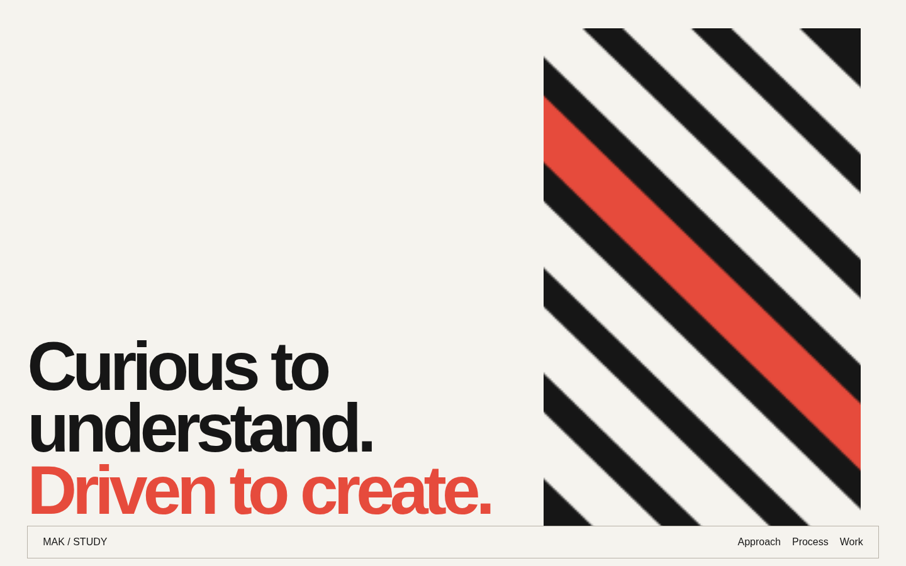
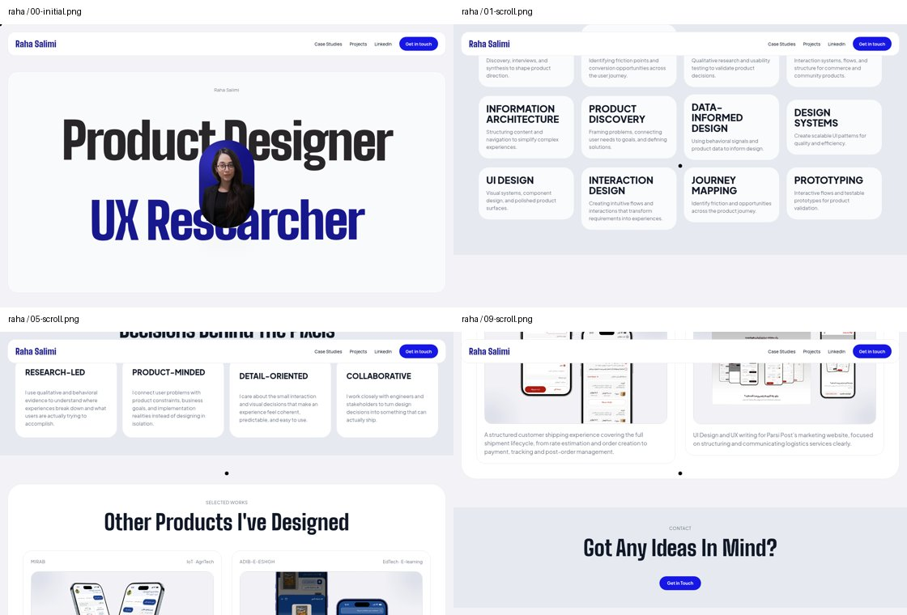
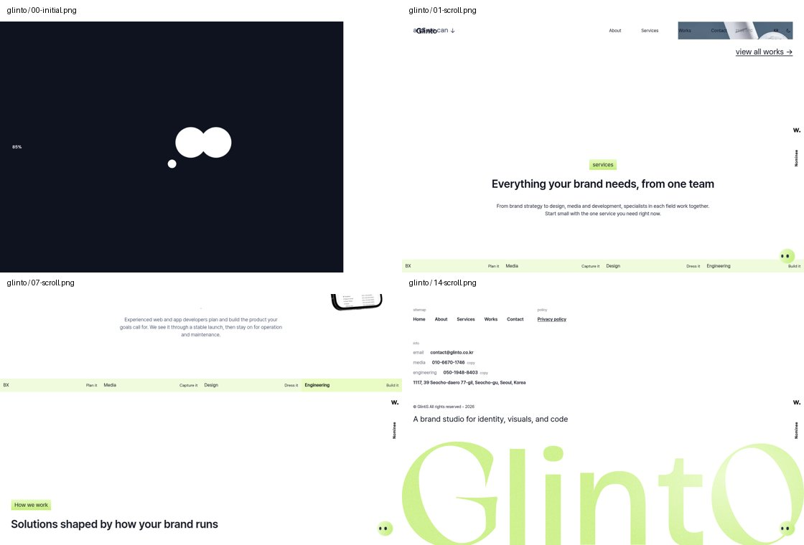

# Portfolio reference study

Research date: **15 November 2026, Asia/Tehran**. Four user-selected references, with extra depth on Tom de Koning.

## Read and try

1. [Full site-by-site technical study](STUDY.md): observed interactions, source mechanisms, parameters and limitations.
2. [Implementation guide](BUILD-GUIDE.md): reusable patterns, architecture and lifecycle rules.
3. [Runnable motion lab](motion-lab/index.html): original examples with local pinned dependencies.
4. [Validation evidence](validation.json), [public source index](source-index.json), and [lab test results](motion-lab/test-results.json).

Run from this directory:

```sh
python3 -m http.server 4173 --bind 127.0.0.1 --directory motion-lab
```

Open port 4173 in a browser on that machine. No installation is needed to run the lab. It uses original geometric frames and placeholder panels, not the reference sites' assets or project claims. This is a learning artifact, not the finished portfolio.



[Mobile lab screenshot](figures/lab-mobile.png)

The cloud machine provides Playwright and Chromium. With the server running:

```sh
node motion-lab/test.cjs
```

Elsewhere, run `npm ci` in `motion-lab` to install the test dependency. Set `STUDY_CHROMIUM` to your Chromium executable; `LAB_URL` overrides the local address.

## 1. Raha Salimi

https://raha-salimi.vercel.app/ — native scrolling, Motion springs, layered hero parallax and viewport reveals.



## 2. Glinto

https://glinto.co.kr/en — Lenis, service text transitions and a horizontal process runway. The first sample catches its intro; the separate settled follow-up inspected the loaded hero.



## 3. Tom de Koning — primary reference

https://www.tomdekoning.work/ — portrait sequence, traveling navigation, character reveals and a draggable WebGL carousel.


## 4. AW Media

https://awmedia.marketing/ — sticky project stacking, device demonstrations and process progression.


## Evidence and reproduction

Coverage includes all four homepages and representative interactions, not every route or browser. Twelve coarse Chromium captures cover desktop, mobile and reduced motion. Targeted probes cover additional navigation and interactions. Exact stopping conditions are recorded in validation.json.

Findings distinguish **observed**, **source-verified**, and **proposed reconstruction**. Source parameters describe the inspected version. Library presence alone is not behavioral evidence.

Browser requests used TLS-verified Playwright API fetching with the environment CA because Chromium's native trust store rejected the proxy certificate. The content still executed in Chromium, but network/streaming timing differs; these are not performance benchmarks.

Screenshots and compact summaries are committed. Full public assets, traces and HTML remain in ignored `evidence/` within the research workspace. source-index.json lists original URLs and local hashes; it identifies formatting applied before hashing.

```sh
node inspect.cjs --self-test
node inspect.cjs raha --verified-fetch
node inspect.cjs glinto --verified-fetch
node inspect.cjs tom --verified-fetch
node inspect.cjs awmedia --verified-fetch
node probe.cjs tom
node probe.cjs awmedia --mobile
```

The collector has explicit limits. Its mobile sweep is programmatic; targeted probes include an emulated touch gesture. No forms were submitted. No environment configuration was changed or published to deliver this study.
