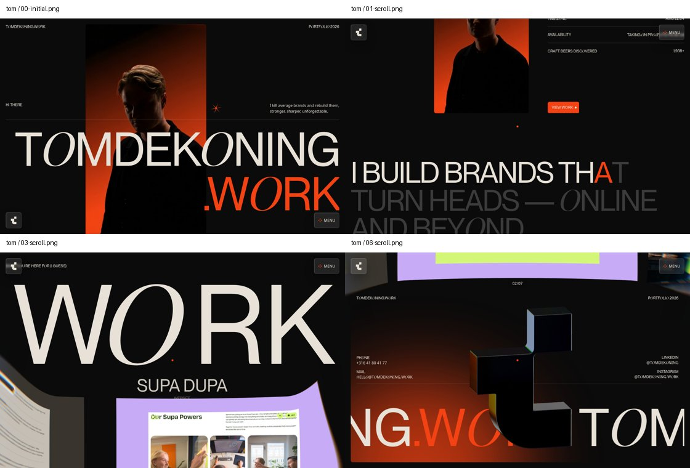
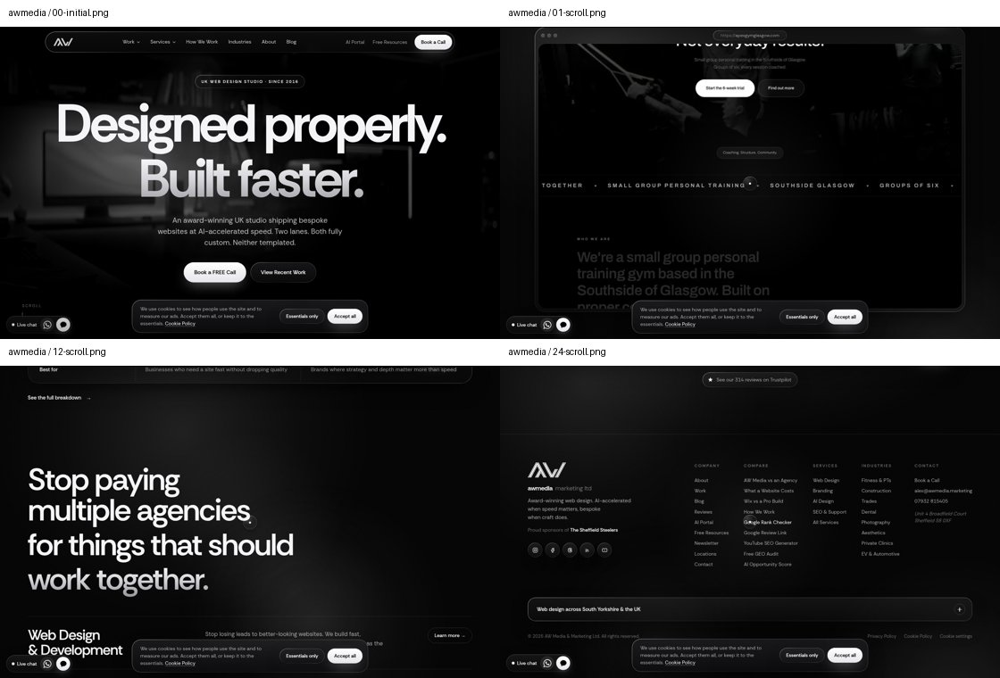

# Portfolio reference study

Initial research: **15 November 2026**. Documentation expansion and interaction audit: **16 November 2026 (UTC)**. Four user-selected references, with extra depth on Tom de Koning.

## Read one reference at a time

This is a **documentation and learning library**. The current revision deepens the case studies and adds annotated code; it does not build a portfolio. The earlier motion lab is historical mechanism exploration, not a visual target or an approved design.

| Order | Chapter | Main lesson |
|---|---|---|
| 1 | [Raha Salimi](sites/01-raha.md) | Native scroll, layered depth, route covers and a mobile skills belt |
| 2 | [Glinto](sites/02-glinto.md) | Stable reading areas, intro coordination and measured horizontal travel |
| 3 | [Tom de Koning](sites/03-tom.md) | Portrait/type/navigation choreography, gallery physics and rendering lifecycle |
| 4 | [AW Media](sites/04-awmedia.md) | Persistent device frames, sticky depth, disclosures and glass rendering |

Each chapter distinguishes observed behavior, public-source facts, visual interpretation and original reconstructions. Code inside the documentation explains mechanisms and assumptions; it is not a claim to reproduce the complete websites.

Then read:

1. [How to read motion as a design system](skills/01-motion-reading.md).
2. [Tom's opening choreography, with annotated code](skills/02-tom-choreography.md).
3. [Section-transition patterns and formulas](skills/03-section-transition-patterns.md).
4. [Coverage, verification results and remaining gaps](COVERAGE.md).
5. [Original source-backed technical study](STUDY.md) and [implementation reference](BUILD-GUIDE.md).

The screenshots below are selected scroll samples, not complete interaction evidence. The JSON reports and source trail supply the technical details.

## 1. Raha Salimi

https://raha-salimi.vercel.app/ — native scrolling, Motion springs, layered hero parallax and viewport reveals.


## 2. Glinto

https://glinto.co.kr/en — Lenis, service text transitions and a horizontal process runway. The first sample catches its intro; the separate settled follow-up inspected the loaded hero.


## 3. Tom de Koning — primary reference

https://www.tomdekoning.work/ — portrait sequence, traveling navigation, character reveals and a draggable WebGL carousel.



## 4. AW Media

https://awmedia.marketing/ — sticky project stacking, device demonstrations and process progression.



## Evidence and reproduction

Coverage includes all four homepages and representative interactions, not every route or browser. Twelve coarse Chromium captures cover desktop, mobile and reduced motion. Targeted probes cover additional navigation and interactions. Exact stopping conditions are recorded in validation.json.

Findings distinguish **observed**, **source-verified**, and **proposed reconstruction**. Source parameters describe the inspected version. Library presence alone is not behavioral evidence.

Browser requests used TLS-verified Playwright API fetching with the environment CA because Chromium's native trust store rejected the proxy certificate. The content still executed in Chromium, but network/streaming timing differs; these are not performance benchmarks.

Screenshots and compact summaries are committed. Full public assets, traces and HTML remain in ignored `evidence/` within the research workspace. source-index.json lists original URLs and local hashes; it identifies formatting applied before hashing.

```sh
node inspect.cjs --self-test
node inspect.cjs raha --verified-fetch
node inspect.cjs glinto --verified-fetch
node inspect.cjs tom --verified-fetch
node inspect.cjs awmedia --verified-fetch
node probe.cjs tom
node probe.cjs awmedia --mobile
```

The collector has explicit limits. Its mobile sweep is programmatic; targeted probes include an emulated touch gesture. No forms were submitted. No environment configuration was changed or published to deliver this study.

## Reproduce the follow-up checks

The cloud workspace provides Playwright and Chromium. `audit.cjs` performs read-only interactions and writes compact states and assertions to `audit-results/`. It returns a nonzero exit code for a failed check or an aborted audit. Raw screenshots remain under ignored `evidence/audit/`.

```sh
node audit.cjs raha
node audit.cjs raha --reduced
node audit.cjs glinto
node audit.cjs tom
node audit.cjs awmedia --mobile
```

Elsewhere, install Playwright and provide Chromium through `STUDY_CHROMIUM`. Fixed viewport sizes are 1440×900 desktop and 390×844 emulated mobile. These checks establish specific behavior, not aesthetic quality or complete accessibility.

## Earlier experiment

The existing [motion lab](motion-lab/index.html) and its [test results](motion-lab/test-results.json) remain as historical mechanism experiments. They are not the design recommendation for the portfolio and were not changed in this documentation revision. The learning path above is the current deliverable.
