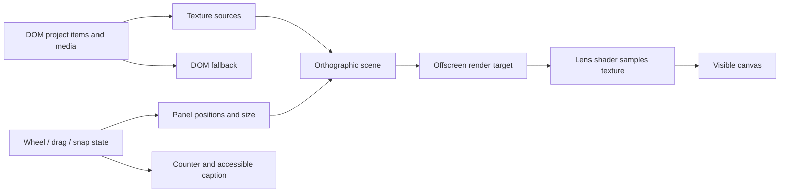

# 3. Tom de Koning — coordinated identity, then an interactive work gallery

Primary reference: https://www.tomdekoning.work/. Public source snapshot: 15 November 2026; follow-up: 16 November. Start with [portrait and type choreography](../skills/02-tom-choreography.md), then this chapter for the gallery, supporting interactions and lifecycle. [Browser audit](../audit-results/tom-desktop-normal.json).

## Composition before code

The opening is dominated by an enormous name, a tall orange-lit portrait and a dark field. Small utility labels sit at the edges. Selected italic letterforms introduce contrast within the otherwise restrained type. The portrait remains recognizable while its frame changes dimensions; the navigation moves from the viewport bottom toward the top. The next statement becomes readable as the identity opening gives way.

**Interpretation:** continuity comes from a few persistent subjects changing roles. Scale, overlap and empty space establish hierarchy before animation begins. The portrait, accent color and letterforms carry identity; the star and cursor are supporting details. This is why a page containing the same libraries and many effects can still feel unrelated to this reference.

## Effect inventory and ownership

| Effect             | Owner / input                        | Verified mechanism                                                       |
| ------------------ | ------------------------------------ | ------------------------------------------------------------------------ |
| Opening cover      | Timed GSAP timeline                  | Portrait clip opens over 1.6s; navigation reveal begins at 1s            |
| Portrait motion    | ScrollTrigger + canvas renderer      | 63 JPGs, scroll-derived frame selection, bounded loading queue           |
| Portrait size      | Separate responsive scroll animation | Desktop 35vw×100vh → 25vw×65vh; mobile 60vw×50vh → 90vw×70vh             |
| Traveling nav      | Coalesced document scroll/resize     | `max(0, H - navHeight - scrollY)`                                        |
| Reading color wave | SplitText + crossed-character state  | Accent briefly flashes before final color; reverses on backward crossing |
| Masked headings    | SplitText line masks + timed reveal  | yPercent 120 → 0; top 85% trigger; replay/reset                          |
| Decorative rules   | Scroll-triggered width reveal        | 1.6s expo.out, top 95%                                                   |
| Menu               | Two GSAP timelines + semantic state  | Page shifts 5rem, then panel, then staggered links                       |
| Link hover/focus   | Two character layers                 | ±110% movement, .45s, .018 stagger, .04 offset                           |
| Work gallery       | Input physics + WebGL                | Horizontal wheel, drag, inertia, snap, lens rendering                    |
| Video              | Visibility/player state machine      | HLS/native choice, bounded retries, pause when ineligible                |
| Cursor trail       | Pointer + canvas                     | 250ms point lifetime; variable-width quadratic segments                  |
| Marquee/star       | Time + scroll direction/velocity     | Reversal/boost rather than uniform perpetual movement                    |
| Footer atmosphere  | ScrollTrigger                        | Gradient x −30%, y 20%, scale .85, opacity .6, scrub 1.2                 |
| Clock              | Localized time + visibility update   | Supporting content, not a scroll animation                               |

The full opening geometry and annotated implementation are in the companion chapter. Do not collapse its independent mechanisms into a single eased timeline without checking their progress ranges.

## The gallery has two rendering passes

The source dynamically imports Three.js 0.184.0. Panels with image/video textures are arranged in an orthographic scene. That scene renders into a texture. A second full-screen shader samples the texture through a shaped lens, adding distortion, spectral separation and an animated rim. This explains why CSS `backdrop-filter: blur()` alone cannot recreate this gallery.



Source parameters include a 16-sample spectral loop, dispersion 11, blue `#009dff`, glow 4, DPR capped at 2 and texture detail 1.5. They describe this snapshot, not recommended defaults. Visual similarity depends on lens size, source imagery and panel geometry as much as shader constants.

Original conceptual shader core, **not** the original lens or a complete compilable shader:

```glsl
// Inputs assumed: UV, center, radii, source texture, lens strength.
vec2 q = (uv - center) / radii;
float radius = length(q);
float mask = 1.0 - smoothstep(0.90, 1.0, radius);
vec2 warped = center + (uv - center) *
    (1.0 - strength * clamp(radius * radius, 0.0, 1.0));
vec4 ordinary = texture2D(sceneTexture, uv);
vec4 refracted = texture2D(sceneTexture, warped);
vec4 outputColor = mix(ordinary, refracted, mask);
```

This only teaches the offscreen-texture distortion principle. It omits the inspected implementation's aspect/rotation handling, weighted spectral sampling, rim wave, shimmer, color management and alpha composition. No claim of shader parity or GPU validation is made.

## Input physics is separate from rendering

The gallery accepts horizontally dominant wheel input; vertical wheel input keeps scrolling the page. Control-wheel is ignored so zoom gestures are not captured. Delta units are normalized. Pointer capture keeps a drag coherent when the pointer exits the canvas. Touch uses `pan-y` so the browser retains vertical gestures.

Source values: follow .09; touch follow .22; wheel multiplier 1.4; mouse drag 1.6; touch drag 1; friction .865; snap after 120ms idle; snap follow .05. Drag click suppression uses 6px for mouse and 12px for touch. Clicking an off-center panel centers it; clicking the centered panel follows its link.

An original reconstruction of frame-rate-independent following:

```js
function follow(current, target, fractionAt60Hz, elapsedMs) {
  const frames = Math.min(elapsedMs / (1000 / 60), 3);
  const alpha = 1 - Math.pow(1 - fractionAt60Hz, frames);
  return current + (target - current) * alpha;
}

function wheelPixels(event, viewportWidth) {
  if (event.ctrlKey || Math.abs(event.deltaX) <= Math.abs(event.deltaY))
    return null; // Caller must leave the native gesture alone.
  const unit =
    event.deltaMode === 1 ? 16 : event.deltaMode === 2 ? viewportWidth : 1;
  return event.deltaX * unit;
}
```

A full controller must also track velocity, last input time, active pointer ID, cancellation, loop wrapping, variable panel widths and snap destinations. The earlier probe observed counter changes from 01/07 to 02/07 on horizontal wheel and 03/07 after dragging. This supports actual interaction, not just source presence.

The inspected custom gallery input code does not define its own arrow-key navigation handler. Do not infer complete keyboard accessibility from pointer success. A reusable implementation should supply real previous/next buttons, focusable project links and a clear active item, independent of the canvas.

## Media eligibility and lifecycle

The player combines visibility, document visibility, manual pause, user initiation, autoplay and motion preference. Native HLS is preferred in a supported ManagedMediaSource case; otherwise Hls.js is used when available. Fatal network errors get at most two retry attempts, media errors one recovery attempt. Rejected `video.play()` promises are handled. The follow-up report sampled some videos playing with readyState 4, then all paused after switching to reduced motion. It does not establish that every stream or codec played successfully.

The gallery tells players which panels are visible. It stops rendering offscreen or while the document is hidden. Its teardown removes listeners and observers and disposes the renderer, render target, geometries, materials and image/video textures. Asynchronous image completions check disposal state. Runtime reduced-motion switching destroys enhanced gallery instances and restores the DOM presentation; switching back can build them again. The follow-up browser audit explicitly checks that round trip.

For the portrait sequence, a generation token rejects obsolete load completions and four concurrent loads bound networking. Drawing uses the nearest available frame, then replaces it when a better frame arrives. Resizing the canvas requires redrawing even if the selected frame has not changed.

## Menu and micro-interactions

Menu semantic state changes immediately: `aria-expanded` follows open state; the link wrapper becomes inert while closed. The animation shifts the page, opens the wrapper and reveals links in phases. Escape closes it and focuses the trigger. Reduced motion seeks the timeline endpoint. This menu is not evidence of a modal focus trap; the inspected function does not implement one.

The cursor trail is a short history of the smoothed dot, not a long chain of HTML circles. Points expire after 250ms; velocity changes width from roughly 16px toward 2px; alpha fades quadratically. Rendering stops when no points or movement remain. This is a useful lifecycle lesson, even when a custom cursor would be unnecessary for another portfolio.

## Source trail and boundaries

Main readable public script: https://slater.app/20917/64158.js (`4c30270ca413.js` in [source-index.json](../source-index.json)). Search function names `initImageSequenceScroll`, `initSequenceElementResize`, `initGradientWaveText`, `initMenuIcon`, `initBunnyPlayerBackground`, `initLiquidGlassCarousel`, `initDrawPathCursorEffect`. CSS snapshot: `0e945448dd26.css`.

Covered: homepage desktop/mobile/reduced capture, opening scroll positions, menu state/focus, gallery wheel/drag and runtime motion-preference fallback. Not established: every outbound project destination, shader equivalence on other GPUs, native HLS across browsers, deliberately injected WebGL/network failures, complete keyboard/screen-reader use, or a performance budget on real devices. The Three.js import and gallery are not a prerequisite for learning the opening choreography.
